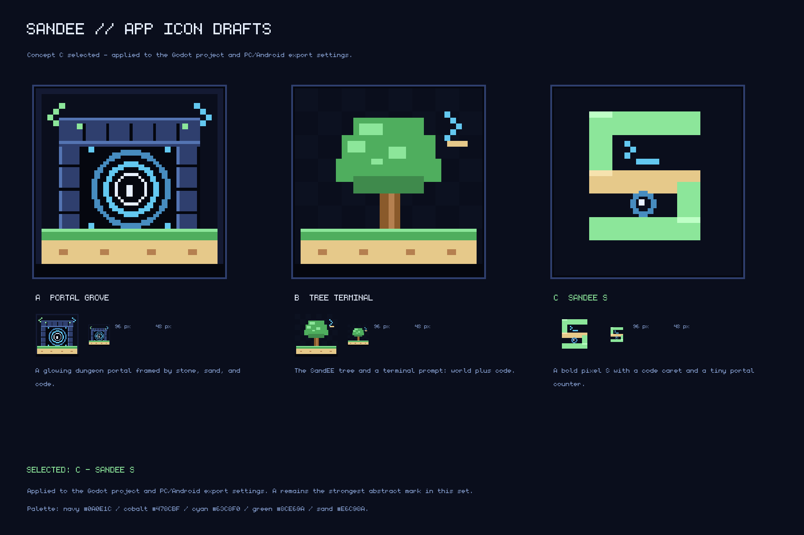

# SandEE app icon drafts

**Selected:** Concept C - SandEE S was applied to the Godot project and PC/Android
export settings on 2026-10-29. The files here remain the design source.

The production copies live in `SandEEAlpha/icons/`.

## Concepts

| Concept | Direction | Why it fits SandEE |
|---|---|---|
| **A - Portal Grove** | Glowing dungeon portal framed by pixel masonry, with a sand/grass base and code glyphs. | Strongest at small sizes and combines the game's dungeon, open-world, and programming identity. |
| **B - Tree Terminal** | The SandEE tree with a terminal caret resting beside it. | Most brand-safe: a direct evolution of the website logo and the "learn by playing" idea. |
| **C - SandEE S** | A chunky pixel `S` with a code caret and a small portal in the counter. | Best as a bold monogram or store-listing mark; least literal about the game world. |

**Selected:** **C - SandEE S**. It was chosen for the app icon because the bold monogram
stays legible at launcher sizes and works as a recognisable brand mark. A remains the
strongest world-specific concept if the icon is revisited later.

## Files

- `concept_a_portal_grove_1024.png` - master draft, 1024x1024
- `concept_b_tree_terminal_1024.png` - master draft, 1024x1024
- `concept_c_sandee_s_1024.png` - master draft, 1024x1024
- `concept_*_source_64.png` - 64x64 pixel source for each concept
- `sandee_app_icon_concepts.png` - presentation sheet with 96 px and 48 px previews

## Palette

| Role | Hex |
|---|---|
| Background navy | `#0A0E1C` |
| Panel navy | `#141A33` |
| Cobalt | `#478CBF` |
| Cyan glow | `#63C8F0` |
| Green | `#8CE69A` |
| Grass | `#4FAE5E` |
| Sand | `#E6C98A` |
| Shadow | `#05070F` |

## Notes for a future implementation

- Keep the master artwork at 1024x1024 and preserve the 64x64 pixel grid.
- Android adaptive icons should separate the background (sand/stone/ground) from the
  foreground (portal/tree/S) if this direction is chosen.
- Test the final foreground inside the adaptive-icon safe zone; concept A's current
  frame reaches close to the edges.
- Do not replace the current launcher icon until a concept is selected.
