# SandEE Account Authentication Flowchart

This document describes the account authentication flow implemented in the current SandEE project. It is written for the thesis documentation set and can be edited directly; the diagrams are Mermaid flowcharts.

**Scope:** username-and-password authentication only. SandEE does not implement email registration, email verification, Google or other OAuth sign-in, magic-link sign-in or password recovery. Registration is implemented and is included below.

**Source of truth:** `scripts/startup_mode.gd`, `scripts/online_account_panel.gd`, `scripts/supabase_client.gd`, `scripts/global.gd`, `scripts/main_menu_ver.gd` and `scripts/cloud_sync.gd`.

The flow is divided into eleven connected parts so each diagram stays readable on an A4 portrait page. Each part begins with the screen or action that continues from the previous part.

---

## Part 1. Launch and online availability

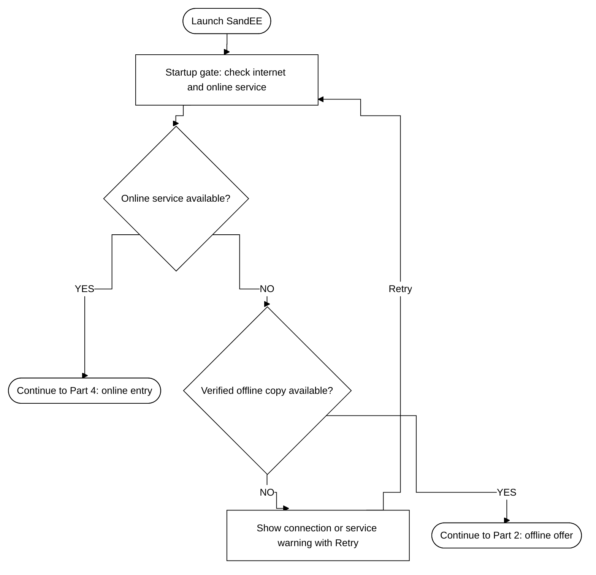

If the player closes the account panel, the startup gate remains available and the online button can be pressed again.

---

## Part 2. Offline offer and service re-check

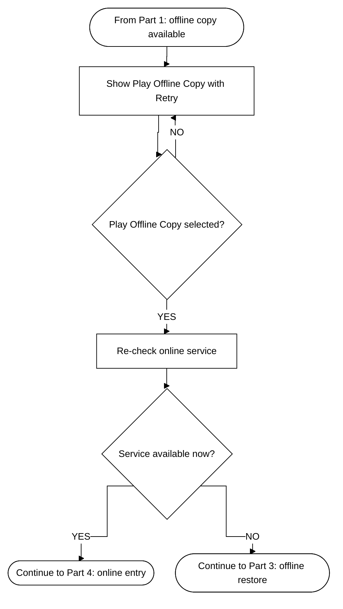

---

## Part 3. Offline restore and main menu

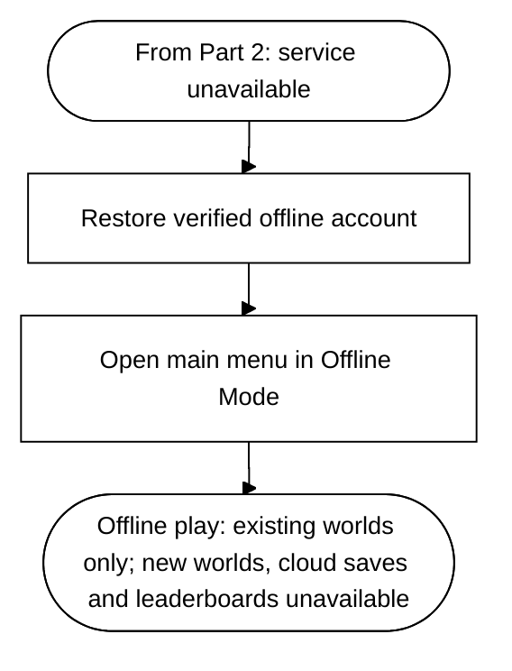

Offline mode is bound to the account that last verified the local copy. Worlds belonging to other accounts stay hidden. After signing in, the main menu's **Play Offline** control returns to the same offline mode without signing out.

---

## Part 4. Online entry and account-transition check

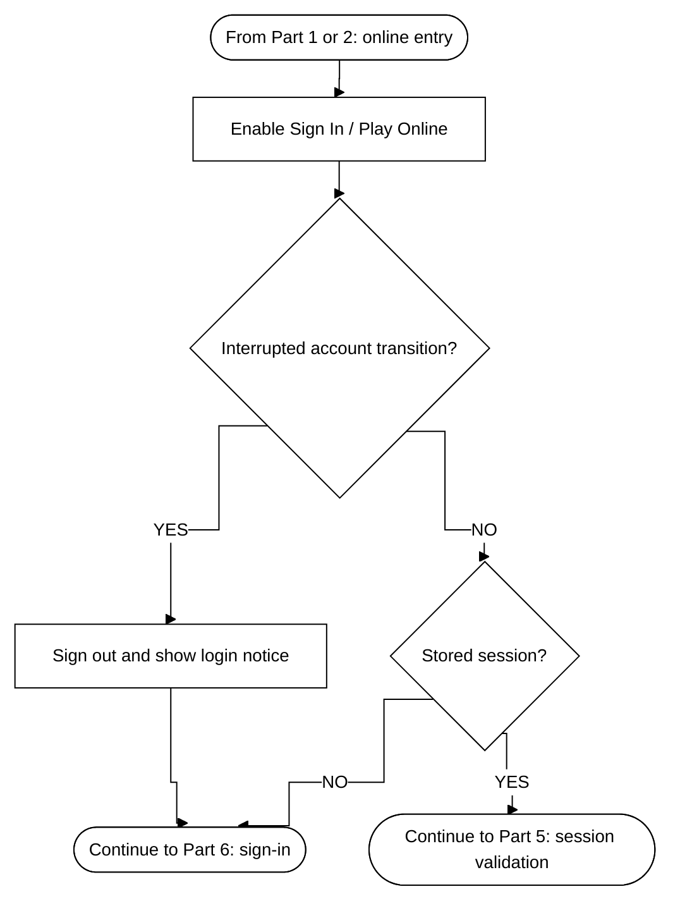

---

## Part 5. Stored-session validation

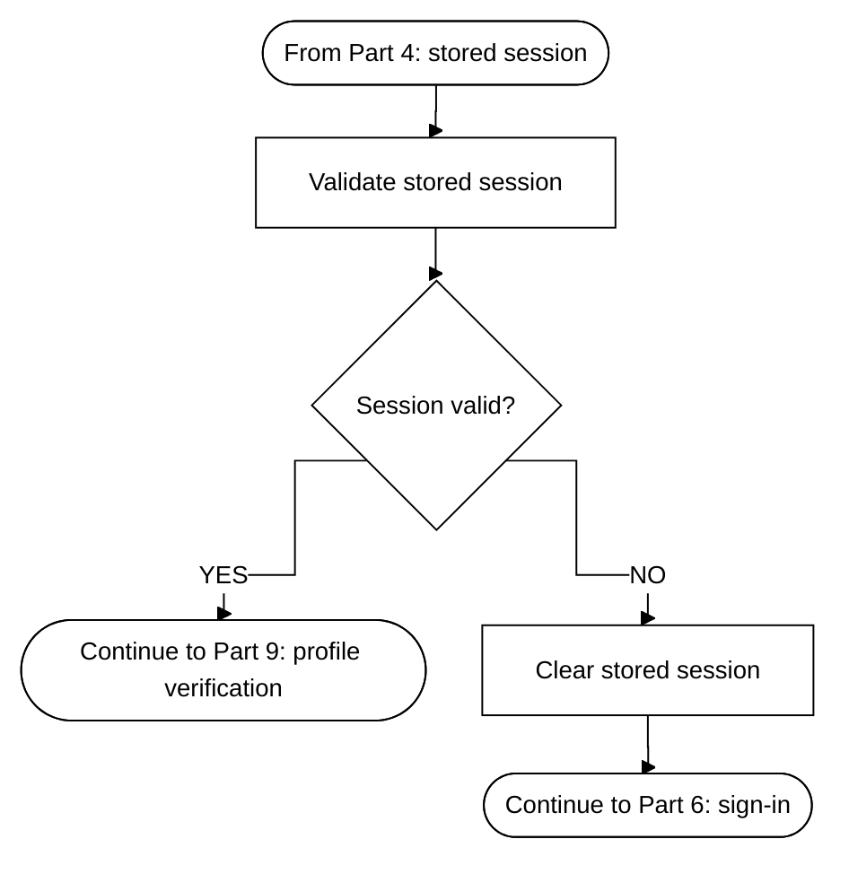

---

## Part 6. Sign-in

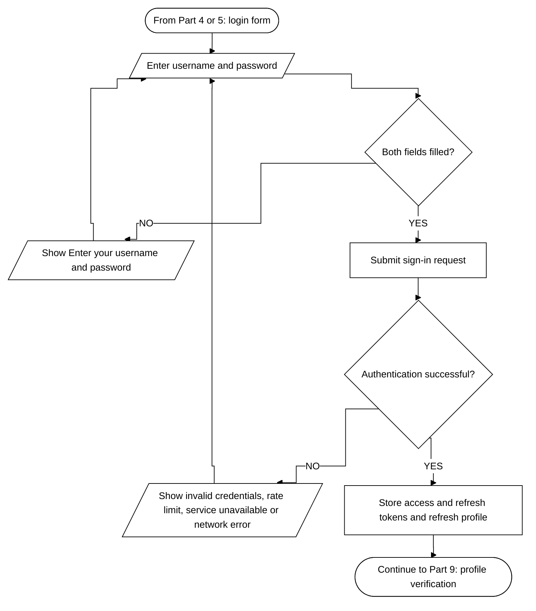

The login form also offers **Create an account**, which continues in Part 7.

---

## Part 7. Registration form and validation

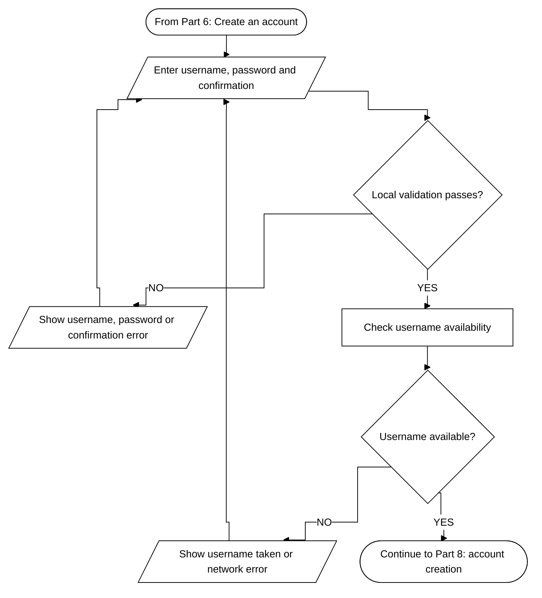

Local validation requires a username of 3 to 24 letters, numbers or underscores, a password of 6 to 72 characters and an identical confirmation.

---

## Part 8. Account creation and session

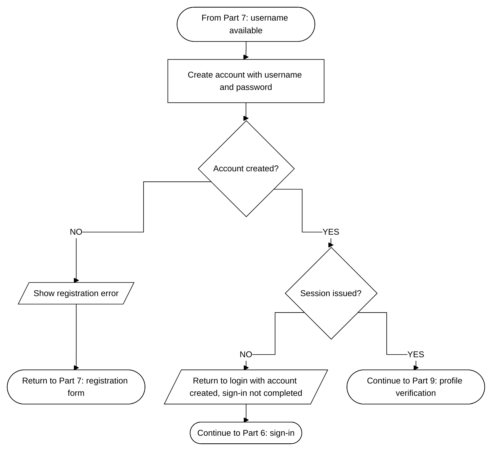

---

## Part 9. Profile verification and account session

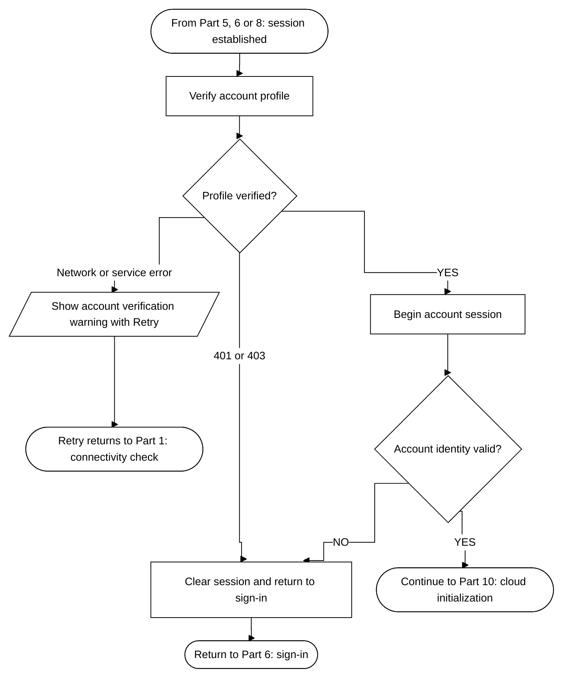

---

## Part 10. Cloud save listing and synchronization

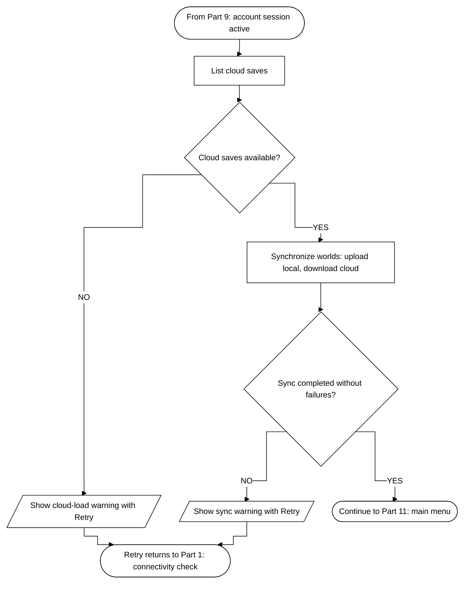

Cloud synchronization is a two-way startup barrier. Local worlds are uploaded and automatically resolvable cloud worlds are downloaded before the main menu opens. A failure does not open the menu; the startup screen shows a retry message instead.

---

## Part 11. Main menu hand-off

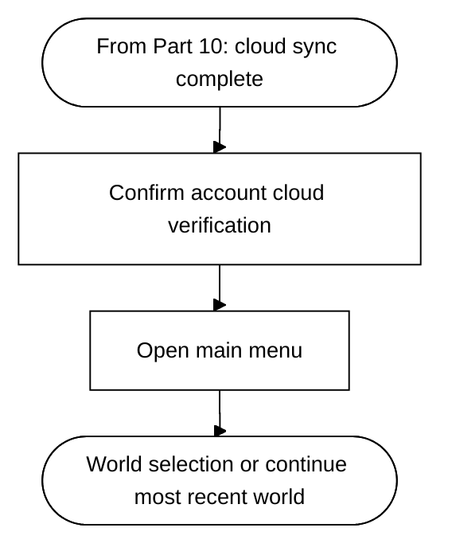

Confirming cloud verification sets the account's cloud-verified flag, clears the interrupted-transition marker and unlocks cloud-scoped actions such as creating a new world. Startup also sends an early leaderboard request before opening the menu; the leaderboard overlay reloads live data, so that request is a prefetch rather than a stored cache.

---

## Flow summary

1. SandEE launches into the startup gate and checks internet access and the online service.
2. If the service responds, the player enters the online flow. A stored session is validated first; an invalid session is cleared before the login form appears.
3. The player signs in with a username and password. Registration is available from the same form and uses the same username-and-password rule set.
4. A successful sign-in or registration stores the session and refreshes the account profile.
5. The profile is verified, the account session begins and cloud saves are listed.
6. Local and cloud worlds are synchronized before the menu opens. A failure keeps the player on the startup screen with a retry message.
7. The main menu opens; the player can continue the most recent world or open world selection.
8. If the online service is unavailable but a verified offline copy exists, the player can open that copy in Offline Mode. Existing verified worlds remain playable, but new worlds, cloud saves and leaderboards are unavailable.

### Source functions

| Step | Implementation |
| --- | --- |
| Startup connectivity and gate | `startup_mode.gd` — `_check_connectivity`, `_apply_connectivity`, `_on_online` |
| Sign-in and registration forms | `online_account_panel.gd` — `_submit_login`, `_submit_register` |
| Validation rules | `online_account_panel.gd` — `_valid_username`, password length checks |
| Authentication requests | `supabase_client.gd` — `sign_in`, `register`, `username_available` |
| Session restore | `supabase_client.gd` — `has_stored_session`, `validate_session`, `sign_out` |
| Account state | `global.gd` — `begin_account_session`, `restore_offline_account`, `enter_offline_mode` |
| Cloud saves and sync | `supabase_client.gd` — `list_saves`; `cloud_sync.gd` — `sync_all` |
| Main menu hand-off | `startup_mode.gd` — `_enter_online`, `_go_to_menu` |

## Rendered PNG files

The combined poster `account_authentication_flowchart_all.png` arranges Parts 1-11 in reading order across four columns. The diagrams are also provided as high-resolution PNGs (3? render scale, white background) under `manual_assets/diagrams/account_authentication/`:

| Part | PNG | Pixel size |
| --- | --- | --- |
| 1 | `part-01_launch_and_online_availability.png` | 1614 ? 2736 |
| 2 | `part-02_offline_offer_and_service_re_check.png` | 1113 ? 3147 |
| 3 | `part-03_offline_restore_and_main_menu.png` | 711 ? 1458 |
| 4 | `part-04_online_entry_and_account_transition_check.png` | 1296 ? 2565 |
| 5 | `part-05_stored_session_validation.png` | 1194 ? 1977 |
| 6 | `part-06_sign_in.png` | 1641 ? 3354 |
| 7 | `part-07_registration_form_and_validation.png` | 1491 ? 3000 |
| 8 | `part-08_account_creation_and_session.png` | 1779 ? 3090 |
| 9 | `part-09_profile_verification_and_account_session.png` | 1722 ? 3255 |
| 10 | `part-10_cloud_save_listing_and_synchronization.png` | 1710 ? 3318 |
| 11 | `part-11_main_menu_hand_off.png` | 612 ? 1206 |
| All | `account_authentication_flowchart_all.png` | 5550 ? 8230 |
