# Abstract

SandEE is a two-dimensional sandbox game about gathering, building, survival, exploration and learning to program. This manual is the official player guide for the Windows and Android editions. It explains how to start a world, learn the controls, gather and craft, survive the overworld, clear the dungeon missions and complete the mission tracks.

The manual follows the game from first launch to the later missions. Chapter 2 describes how to play: the mission tracks, how stars are earned and a practical routine for clearing dungeons. Later chapters cover controls, inventory, crafting, caves and troubleshooting. The two programming chapters list every custom Automatica and Algorithmica function so players can automate work once they know the game.

Screenshots throughout the manual show the interfaces and actions described. Function tables give the exact name, arguments and effect of each custom function, and the contents and cross-references let players jump straight to the system they need.

# Chapter 1. Introduction

## 1.1 About SandEE

SandEE is a two-dimensional sandbox game that combines gathering, building, survival, exploration and introductory programming. Players explore a generated world, gather resources, craft tools, build structures, farm, fish, fight creatures and descend into caves and dungeons. The world is designed to support both short play sessions and long-term building projects.

Two programming environments are part of the game. Automatica gives players a programmable Lua robot that performs work in the world. Algorithmica gives players a Python-based interface for automating crafting stations and furnaces. Dungeons introduce programming concepts through short lessons, Knowledge Altars, quiz questions and practical code exercises.

SandEE is available for Windows and Android. The two editions share the same world rules, crafting systems and programming environments, but they use different control schemes. This manual identifies platform differences wherever they affect how a feature is used.

## 1.2 Purpose and Audience

This manual is the official reference for players of SandEE. It explains what each feature does, how to reach it, what the player should expect after using it and which restrictions apply. It is written for new players who need a guided introduction, for experienced players who need a quick control or programming reference, and for instructors who use SandEE as a classroom or workshop tool.

The manual assumes no previous experience with SandEE. It does assume that the reader can use a keyboard and mouse or a touch screen, and that the reader can follow short code examples. Programming chapters explain the game-specific functions before presenting complete programs.

## 1.3 Using This Manual

Screenshots are included beside the instructions they illustrate. A figure may show a menu, a world interaction, a programming editor or the result of an action. When an action changes the interface, the manual shows both the initial state and the result where a screenshot is available.

Code examples use a monospaced block. Function names, parameters and interface labels are also identified in the surrounding text. The examples are complete enough to run, but players should read the accompanying explanation before changing recipe names, item names or quantities.

Platform differences are marked in the text and in comparison tables. Unless a section states otherwise, a feature is available on both Windows and Android. Android instructions use touch terminology such as tap, hold and drag; Windows instructions use click, hold and drag.

## 1.4 Supported Platforms and Known Limitations

SandEE supports Windows desktop and Android touch devices. The Windows edition uses keyboard and mouse controls. The Android edition uses an on-screen joystick, action buttons and touch gestures. Both editions support the same world types, crafting systems, dungeons and programming environments.

Some account features depend on the online service. SandEE uses username-and-password authentication. Email registration, Google sign-in and password recovery are not available. Cloud saves, leaderboards and account switching require an active online session. A previously verified offline world can be played without a live session, but new worlds must be created online.

Algorithmica accepts a restricted subset of Python syntax. Imports, f-strings, list comprehensions, function definitions, chained comparisons and `else` branches are not supported. The programming chapter explains the supported syntax and the recommended way to write station and furnace programs.

The Android screenshots in this manual show the mobile interface in the game's mobile mode. Physical-device cutouts, gesture navigation and on-screen keyboard placement can vary by device.

## 1.5 Chapter Overview

Chapter 2 explains how to play: the mission tracks, the star system and a practical dungeon routine. Chapter 3 covers installation, startup and the account. Chapter 4 explains sign-in and account management. Chapter 5 covers the main menu and world management. Chapter 6 describes the gameplay interface. Chapters 7 and 8 document Windows and Android controls. Chapter 9 covers exploration, gathering, combat and waypoints. Chapter 10 covers inventory and items. Chapter 11 covers crafting and stations. Chapter 12 covers dungeons and missions. Chapter 13 covers caves. Chapters 14 and 15 list the Automatica and Algorithmica functions. Chapter 16 covers settings and help. Chapter 17 covers troubleshooting. Chapter 18 concludes the manual, and Chapter 19 contains the appendices.

# Chapter 2. How to Play SandEE

## 2.1 What You Can Do

SandEE is a sandbox with no timer and no game-over screen. Play at your own pace: explore the world, gather resources, build a base, craft equipment, farm, fish, fight creatures and enter dungeons. The dungeon missions are grouped into the Python track and the Lua track, and twenty side missions add optional goals.

Progress is recorded by the mission tracker and the star summary. The tracker lists the missions you can take next, and the stars record how cleanly each dungeon was cleared. A zero-star clear still counts, so a difficult run never blocks the next mission.

## 2.2 Mission Tracks

{{tab:dungeon-tracks}} lists the mission tracks. The mission tracker on the right side of the HUD shows the active missions; choose **View All Missions** to see the full list. The first dungeon is part of the tutorial, and later missions unlock as their prerequisites are met. Each dungeon adds a Knowledge Entry to the Programming Encyclopedia.

Table: Dungeon mission tracks. {#tab:dungeon-tracks}

| Track | Indices | Content | Final state |
| --- | --- | --- | --- |
| Python | 1–10 | Print, integers, variables, strings, conditionals, loops, functions and related concepts. | Unlocks later Python missions as prerequisites are met. |
| Lua | 11, 26–39 | Lua print, variables, tables, loops, functions, conditions and automation concepts. | The final mission track; lists every Lua dungeon. |
| Side missions | 20 missions | World, cave, combat, fishing and automation objectives. | Optional goals; remain available alongside the tracks. |

Three habits carry a run:

- Follow the tracker: it always names the next available mission.
- Clear the Python missions before the Lua missions; the Lua track assumes the same quiz skills.
- Prepare for the final Lua mission with a sword, food and full health.

## 2.3 Earning Stars

Every dungeon starts with three blue stars. A hint or a wrong answer removes one, and the first main dungeon offers free hints. The run still clears at zero stars and still grants its reward. Yellow stars are mission rewards, and a three-star clear adds a perfect-clear bonus. {{fig:quiz-results}} shows a two-star result.

Table: Dungeon quiz scoring. {#tab:dungeon-scoring}

| Event | Star effect | Notes |
| --- | --- | --- |
| Start a dungeon | 3 blue stars available | Stars are awarded for the run, not stored as currency during the run. |
| Reveal a hint | −1 star | Free in the first main dungeon. |
| Wrong compiler output | −1 star | The question does not advance. |
| Wrong multiple-choice answer | −1 star | The question does not advance. |
| Clear all questions at 0 stars | Clear still counts | The reward and mission completion are granted. |
| Clear all questions at 3 stars | Perfect clear | Recorded as the dungeon's best result. |

Blue stars measure how cleanly a dungeon was solved; yellow stars measure how much of the mission list is complete. Both totals appear in the top-right of the HUD.

## 2.4 A Play Routine

1. Finish the tutorial or skip it, then craft a basic axe, pickaxe and sword.
2. Place a Bonfire near your base and keep it active. It is your respawn point.
3. Activate each Skyglass Waypoint you pass. Fast travel shortens every supply trip.
4. Carry food in the hotbar. Select it and click yourself to eat and restore health; on Android, tap yourself.
5. Enter caves and dungeons with a full set of tools. The knowledge room in a dungeon heals you and keeps enemies out.
6. Answer quiz questions before spending a hint; hints are free only in the first dungeon.
7. Take the clear even at zero stars, then replay later for a better result.
8. After both tracks, use Automatica and Algorithmica to automate wood, ore and crafting while you finish the side missions.

# Chapter 3. Installation and Startup

## 3.1 Obtaining the Game

SandEE is distributed as a compressed Windows archive and an Android APK. Extract the Windows archive and run the executable from its folder. Install the Android package through the device's normal package installer.

This manual describes the current public release. Small differences may exist between a public download and a development build.

## 3.2 First Launch and the Startup Gate

The game opens a startup gate before the title menu. The gate checks whether the device is online and whether SandEE's online service responds. The gate is shown in {{fig:startup-online}} when both checks succeed. The primary button reads **Sign In / Play Online**. The status line reports **Online services available**, and a second line explains that signing in synchronises worlds, cloud saves and leaderboards.

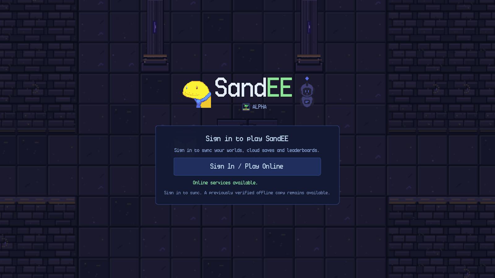{#fig:startup-online}

When either check fails, the gate disables the online button and displays a retry control. The status line reads **Internet connection required**. The panel still notes that a previously verified offline copy remains available, but the startup gate itself does not provide an offline-play button; offline entry is offered later from the main menu's online controls.

The startup gate has three interactive elements: the **Sign In / Play Online** button, the **Retry** button that appears when the check fails, and the account form that opens after a successful check. Pressing Retry re-runs the connectivity check and re-enables the online button if the service becomes reachable. Pressing the online button opens the shared account panel described in Chapter 4. If the panel is cancelled, the gate remains available for another attempt.

## 3.3 Loading a World

After a world is selected, the game shows a dedicated loading screen while terrain, foliage, structures, waypoints, mobs and the player are prepared. The screen displays the title **SandEE Alpha**, a status line such as **Growing grass… 7%** and a progress bar. The loading screen is removed with a short fade after generation completes. The player remains frozen until the fade ends, so input cannot act through the overlay.

SandEE generates a large overworld. Loading time depends on the device and the amount of content being created. The loading screen reports progress by phase, so the percentage can pause briefly while a heavy phase runs.

## 3.4 Startup Failure Behaviour

If the online service is unreachable, the gate reports the failure and offers Retry. If a saved session can no longer be validated, the game returns to the sign-in form. A network outage does not sign the player out. If the player cancels the account panel, no world is loaded and the gate remains in its current connectivity state.

# Chapter 4. Account Registration and Authentication

## 4.1 Signing In

SandEE uses a username and password. No email address is required, and the form states **No email needed — your username is your login.** Sign-in, registration and the signed-in account view share one account panel. Google sign-in, other OAuth providers, magic-link login and password recovery are not available.

{{fig:login}} shows the sign-in form. Enter a username and password and press **Sign In**; an empty field produces **Enter your username and password.** A failed attempt reports **Incorrect username or password.** or a connection message.

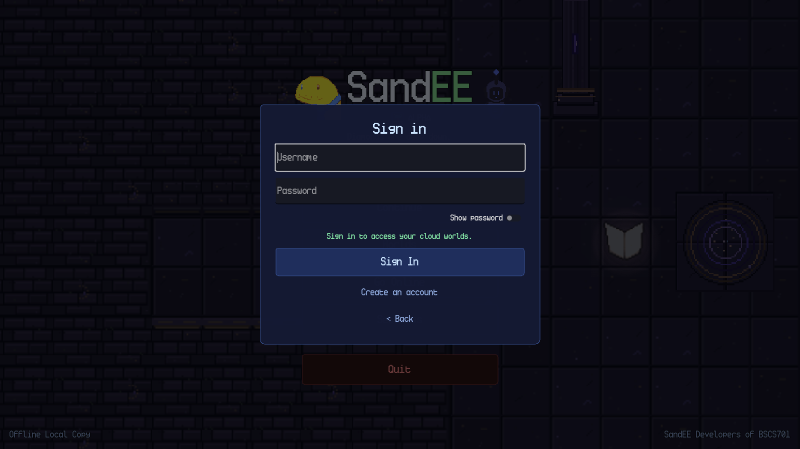{#fig:login}

## 4.2 Creating an Account

{{fig:register}} shows the registration form. Choose a username of 3–24 letters, numbers or underscores, and a password of 6–72 characters, then repeat the password. The **Show Password** toggle reveals both fields.

The rules are checked before the username is sent, so an invalid form is rejected with an inline message. If the username is already taken, the form asks for another one.

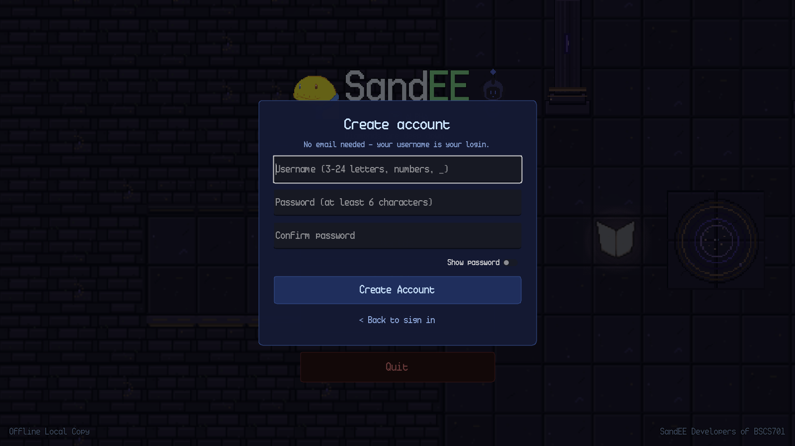{#fig:register}

## 4.3 Signing Out and Playing Offline

The account control in the main menu opens the signed-in profile and provides **Sign Out**. Sign out before switching accounts.

A previously verified world can be opened without a live connection. New worlds, cloud saves, leaderboards and account switching require an online session.

# Chapter 5. Main Menu and World Management

## 5.1 Main Menu Layout

The main menu presents a large SandEE logo, the tagline **Sand got everywhere.**, a vertical button stack and a footer. The footer reports the current mode, for example **Offline Local Copy** or **Offline**. The lower-right corner reports **SandEE Developers of BSCS701**. The background is a slowly panning deterministic world panorama.

{{fig:main-offline}} shows the menu in verified offline mode. The buttons are **Continue**, **Worlds**, **Go Online**, **Settings** and **Quit**. With an online session, the online control becomes the account/online entry point and the status area reports the online state.

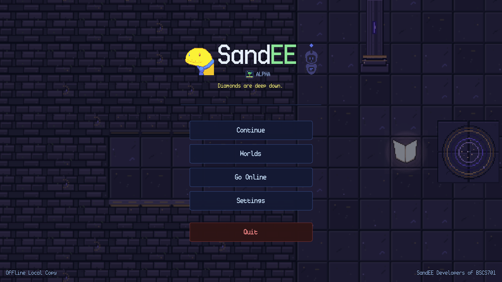{#fig:main-offline}

The main menu actions are summarised in {{tab:main-menu-actions}}. The Continue button is enabled only when a verified account is active and at least one readable world exists; it loads the most recently saved world. The Worlds button opens the world manager. The online button opens the shared account panel when offline, or the account/online controls when online. Settings opens the shared settings panel. Quit closes the application immediately on the main menu; no confirmation dialog is shown there.

Table: Main menu actions. {#tab:main-menu-actions}

| Control | Action | Result | Prerequisite |
| --- | --- | --- | --- |
| Continue | Load the most recent world | Loads the most recent save and opens the world. | A verified account and a readable world. |
| Worlds | Open the world manager | Shows world cards, rename/delete controls and the create form. | A verified account. |
| Go Online | Open the account/online flow | Checks connectivity, restores a cached session or shows the sign-in form. | None; failure leaves offline play available. |
| Play Offline | Switch an online session to a verified offline copy | Re-reads local worlds and updates the status label. | An online session and a verified offline copy. |
| Settings | Open Settings | Shows Audio, Display, Gameplay and Controls categories. | None. |
| Quit | Close the game | Exits the application. | None. |

## 5.2 World Selection

The Worlds overlay is shown in {{fig:worlds}}. Each world card displays the world name and a last-saved timestamp. A pencil button opens the rename dialog, and a red **Delete** button opens the delete confirmation. The lower portion of the overlay contains a **Create a new world** section with a name field and a **Create** button. The **Back** button closes the overlay.

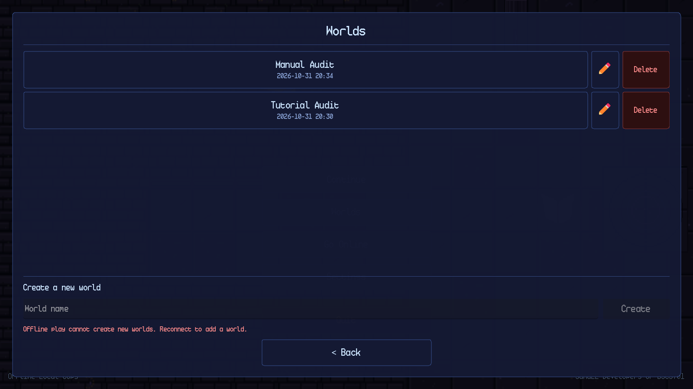{#fig:worlds}

World creation is online-only. In offline mode the create field is visible but the form reports **Offline play cannot create new worlds. Reconnect to add a world.** The Create button remains disabled. When the account is online and cloud-verified, a unique name enables the button. Creating a world uses the lowest free slot, opens the world and generates a new world. A world name must be non-empty, unique across the account's worlds and no longer than 40 characters in the rename dialog; the create field itself is validated by the same name-free check.

A duplicate name produces the inline message **That name is already used by another world.** and keeps the Create button disabled. An empty name produces **Enter a name for your world.** and the same disabled state. The game supports at most ten worlds per account; once the limit is reached, the next-free-slot lookup returns no slot and creation is refused.

## 5.3 Rename and Delete

The rename dialog is opened from the pencil button on a world card. It contains a name field, a **Cancel** button and a **Rename** button. The same free-name rule applies. A successful rename updates the world card and the save metadata without touching any other slot.

Deletion always asks for confirmation. The message includes the world name and the warning **This cannot be undone.** Cancel is the default action. Confirming deletes the world and records the deletion when online.

## 5.4 Main Menu Failure Behaviour

If no world exists, Continue is disabled; open Worlds to create one. If the account is offline, the menu keeps the last verified world playable and reports the status in the footer. If the online check fails, **Retry** runs it again. Quit closes the game normally.

# Chapter 6. Gameplay Interface

## 6.1 The Gameplay HUD

The gameplay HUD is shown in {{fig:hud}}. It remains visible during normal exploration and is dimmed or hidden when a modal panel opens. The HUD is composed of the following elements: the minimap in the upper-left, the Automatica status panel in the left-middle, the pause button and star summary in the upper-right, the mission tracker below them, the health and stamina bars above the hotbar, the nine-slot hotbar at the bottom-centre, the selected-item label above the bars and the contextual control hints in the lower-right.

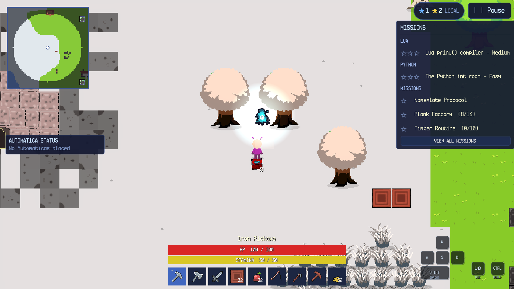{#fig:hud}

{{tab:hud-elements}} describes each element and its behaviour. The layout adapts to different window sizes and to Android safe areas. On Android, the hotbar reserves its last slot for the **INV** button, leaving eight item slots; the desktop hotbar has nine item slots.

Table: Gameplay HUD elements. {#tab:hud-elements}

| Element | Location | Purpose | Interaction |
| --- | --- | --- | --- |
| Minimap | Upper-left | Shows explored terrain, the player, creatures, structures and waypoints. | Click or press M to open the full map. |
| Automatica status | Left-middle | Lists the most recent Automatica units and their current job. | Click the panel to expand the full list where available. |
| Star summary | Upper-right, left of Pause | Shows current yellow and blue star totals. | Read-only. |
| Pause | Upper-right | Opens the pause menu. | Click or tap. |
| Mission tracker | Right side | Shows active Lua, Python and side missions with progress. | **View All Missions** opens the full list. |
| Health bar | Bottom-centre | Shows current and maximum health. | Read-only. |
| Stamina bar | Bottom-centre | Shows current and maximum stamina. | Read-only; sprinting drains it. |
| Selected item label | Above health bar | Names the currently selected hotbar item after a change. | Read-only; fades after a short time. |
| Hotbar | Bottom-centre | Holds usable items and blocks. | Number keys, mouse wheel or click/tap. |
| Control hints | Lower-right | Shows movement, sprint, LMB and build bindings; keycaps light while pressed. | F1 toggles on desktop. |
| Notifications | Top-centre | Reports pickups, fishing, deaths, discoveries and warnings. | Read-only; fades. |
| Autosave indicator | Top-centre | Reports **Autosaving… saving progress**. | Read-only. |

## 6.2 Onboarding and the Tutorial Guide

A new world begins in a guided camp. The tutorial director introduces the game through Py-San, a friendly guide, and then presents one short objective at a time. {{fig:tutorial-dialogue}} shows the first dialogue. The dialogue box displays the speaker name, the text, a portrait, a **SKIP LESSON** button and the instruction **Click or Enter to continue • Esc closes**. The world is modal while the dialogue is open.

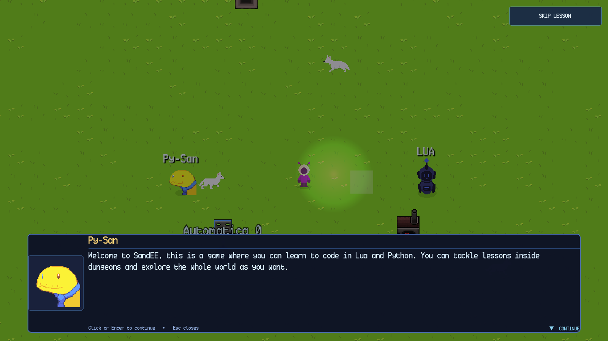{#fig:tutorial-dialogue}

After the dialogue is advanced, the objective card appears at the top of the screen and the target is highlighted in the world. The movement lesson card reads **GUIDED START — Use WASD or the arrow keys to walk to the marker.**, a large arrow points toward the target and the destination is outlined with a pulsing marker. The player can skip the lesson with the **SKIP LESSON** button; skipping does not remove items, features or later content.

The onboarding sequence covers movement, tool selection, tree chopping, wood pickup, crafting-station placement, the first dungeon, the Knowledge Altar, the Quiz Altar, Automatica, Algorithmica, regular caves, Pixie Caves and Skyglass Waypoints. The opening HUD is deliberately reduced and expands as lessons complete. After onboarding, a settings tour highlights the main controls. The tutorial state is stored per world, so an existing world is not forced through onboarding again.

## 6.3 The Full Map

The minimap expands into the full map shown in {{fig:map}}. The map header reads **MAP**, with the instructions **drag to pan • CLOSE / M to close** and a **CLOSE** button. The map canvas shows explored terrain in colour and unexplored areas in dark grey. The legend identifies the player, enemies, friendly creatures, bonfires, Automatica units, crafting stations, furnaces, Color Crafters, dungeons and world waypoints.

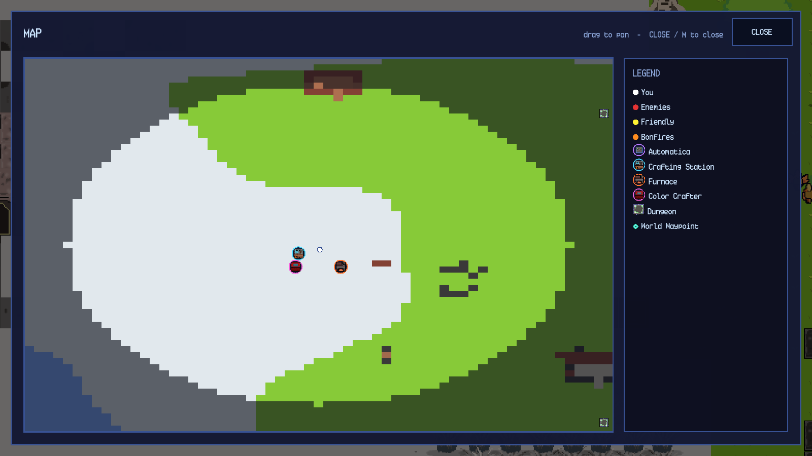{#fig:map}

The map supports dragging to pan and mouse-wheel or plus/minus zoom. The M key toggles it. Markers can be clicked or tapped to travel when the marker type supports travel; the world-waypoint map described in Chapter 9 is the dedicated travel surface. Closing the map returns to gameplay without changing the world state.

## 6.4 Pause Menu

The pause menu contains **Resume**, **Help & Documentation**, **Settings**, **Automatica Management** and **Quit to Menu**. The menu pauses the tree, dims the world and keeps the hotbar visible below the modal layer. **Automatica Management** lists every active Lua unit and is the only player-facing way to terminate one. **Quit to Menu** saves the current world through the normal cleanup path, leaves any cave or dungeon safely and returns to the title menu.

Escape opens the pause menu when no other panel is open and closes the innermost panel when one is open. On Android, the system Back action follows the same overlay order. The pause menu is modal; gameplay input is ignored until it is closed.

## 6.5 Death and Respawn

When health reaches zero, the game shows a red death banner and starts a five-second respawn countdown. {{fig:death}} shows the state at zero health. The player's inventory is not deleted. Build mode and pending actions are cancelled. The player respawns in the overworld at the active Bonfire, or at the world spawn if no Bonfire is active. A death inside a cave or dungeon returns the player to the overworld; a dungeon death restarts at the dungeon entrance rather than deleting the run.

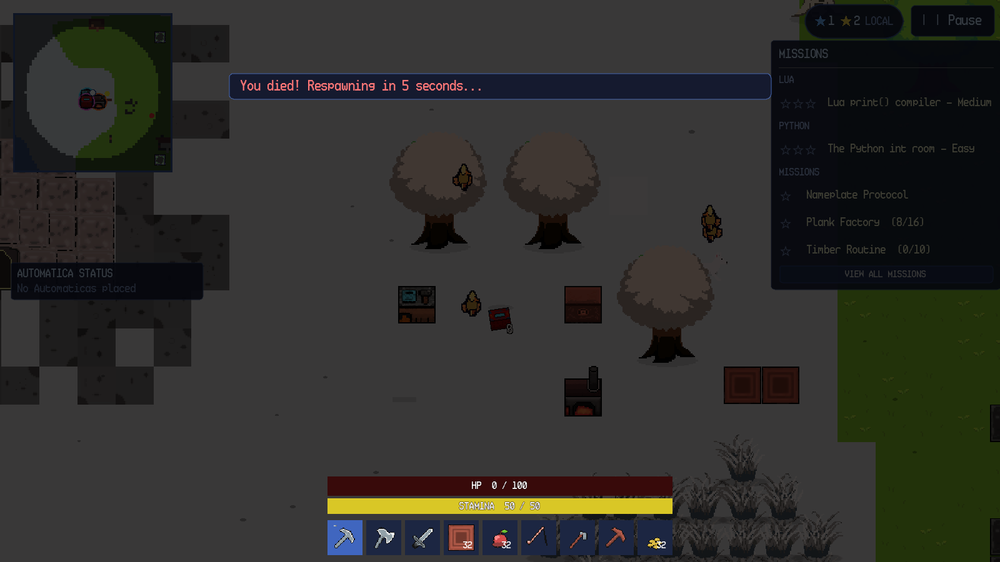{#fig:death}

## 6.6 Notifications and Autosave

Short notifications appear at the top-centre of the screen. They report item pickups, bestiary discoveries, fishing casts, farming results, deaths and validation warnings. The autosave indicator appears in the same region and reads **Autosaving… saving progress** while a save is being written. SandEE saves automatically at regular intervals and after mission progress changes. The indicator does not interrupt play.

# Chapter 7. Windows Controls

## 7.1 Windows Control Reference

Table: Windows keyboard and mouse controls. {#tab:windows-controls}

| Action | Input | Behaviour |
| --- | --- | --- |
| Move | W, A, S, D or arrow keys | Moves in the chosen direction; cancels point-and-click. |
| Sprint | Shift | Runs while stamina remains. |
| Aim | Mouse movement | Sets the direction of swings, tools and placement. |
| Primary action | Left click | Swings, mines, chops, attacks, interacts or places. |
| Point-and-click | Left click on ground or target | Walks to the target and performs the action when enabled. |
| Inventory | E | Opens or closes the inventory. |
| Hotbar | 1–9 or mouse wheel | Selects a hotbar slot. |
| Build mode | Ctrl | Toggles the build grid and ghost preview; unavailable in dungeons. |
| Map | M | Opens or closes the full map. |
| Pause | Escape | Opens the pause menu or closes the innermost panel. |
| Eat food | Left click yourself with food selected | Restores health when health is not full. |
| Destroy object | Shift + left click | Mines a placed block, chest, station or furnace. |
| Drag and drop | Left mouse drag | Moves stacks between inventory, hotbar and chests. |
| Dialogue | Enter or Space | Advances tutorial dialogue. |

## 7.2 Movement, Building and Interaction

Point-and-click movement is enabled in Settings → Controls. A click on open ground walks there; a click on an object walks into range and uses it; a click on an enemy chases and attacks. WASD or Escape cancels the order.

Ctrl shows the build grid. Valid tiles appear in the block's colour and blocked tiles in red. Placement is limited to six blocks, and build mode is unavailable in dungeons. {{fig:build-mode}} shows the grid.

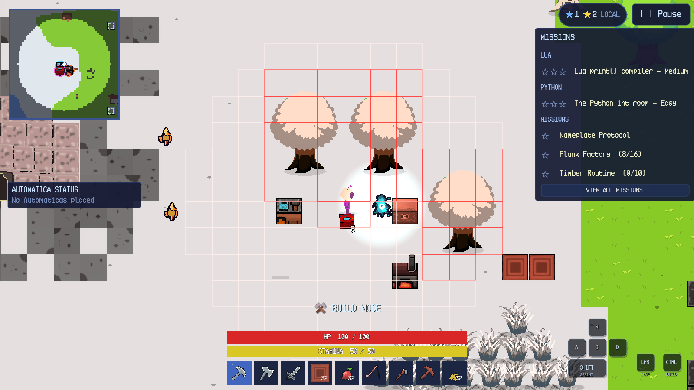{#fig:build-mode}

A plain click on a chest docks its slots beneath the inventory, and items move by dragging between the two grids. {{fig:chest-docked}} shows the combined view. Stations, furnaces and Color Crafters open their own menus. Mining, chopping and fishing use click or hold actions, and Escape closes the innermost panel or opens the pause menu.

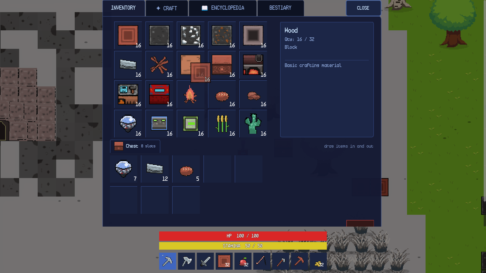{#fig:chest-docked}

# Chapter 8. Android Controls

## 8.1 Mobile HUD

The Android HUD replaces the desktop keyboard hints with a virtual joystick and action buttons. {{fig:android-hud}} shows the layout: the joystick is in the lower-left, **BUILD**, **SPRINT** and **INTERACT** are in the lower-right, and the hotbar has eight item slots plus an **INV** button. The minimap, star summary, mission tracker, health and stamina bars remain in the same logical positions as on desktop.

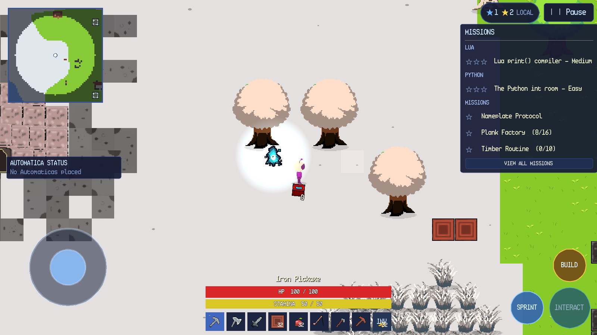{#fig:android-hud}

SandEE displays the mobile layout when it runs on Android. The Android screenshots in this manual show that layout, including the joystick, action buttons and the eight-slot hotbar with INV. Device-specific cutouts, gesture navigation and on-screen keyboard placement can vary by device.

## 8.2 Touch Controls

The movement joystick appears in joystick mode. A second finger can use the action buttons and hotbar while the first finger holds the joystick, so movement and actions are multitouch. **SPRINT** is a hold control. **BUILD** toggles build mode and changes its label to **BUILD ON**. **INTERACT** is contextual: it reads **OPEN** near a chest, **CRAFT** near a crafting station and **SMELT** near a furnace. {{fig:android-interact}} shows the button reading **OPEN** while the player stands beside a chest.

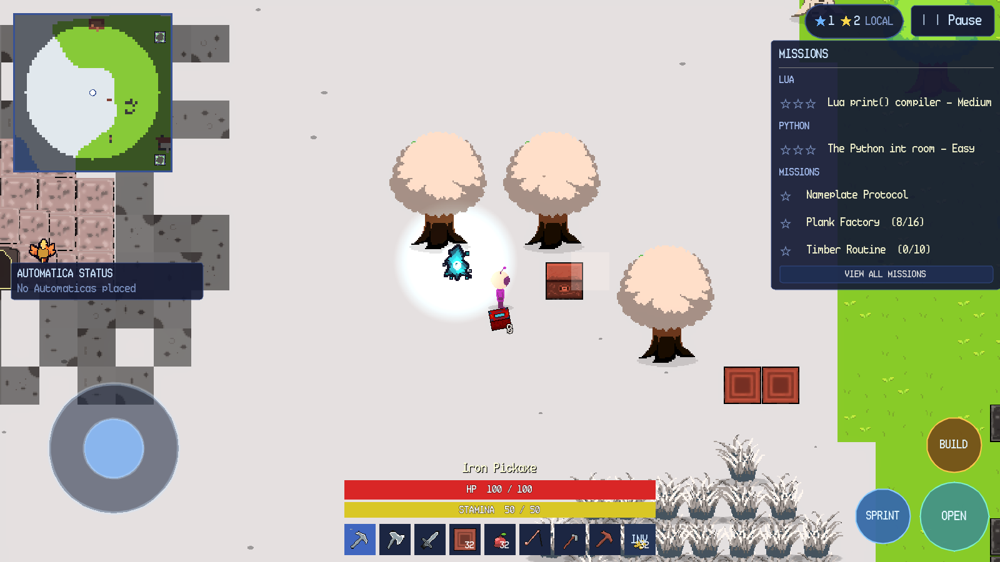{#fig:android-interact}

Tapping the world performs the same action as a desktop left click: it moves under point-and-click, mines or chops the tapped target, attacks a tapped hostile creature, casts a fishing rod at tapped water or places a block in build mode. Tapping the player while food is selected eats the food. The inventory opens from the **INV** slot or the **INTERACT** button where applicable. The inventory keeps the hotbar visible below the panel.

Build mode on Android shows the same translucent ghost and tile grid as desktop and changes the build button label to **BUILD ON**. The map button on the minimap opens the full map. The system Back action closes the current panel or menu in the same order as Escape on desktop.

# Chapter 9. Overworld Gameplay

## 9.1 Exploration and Biomes

The overworld contains plains and forest, desert, snowy land, water, caves and structures. The player explores on foot, by point-and-click or by joystick. A full day/night cycle lasts 24 real minutes: 12 minutes of day and 12 minutes of night. Night increases the hostile population cap and spawn rate. Some creatures appear only at night. Desert entry spawns a group of Desert Worms, and snow biomes can trigger a snowstorm that reduces visibility and movement speed to 55 percent until the player leaves the snow or night falls.

The minimap records explored tiles as the player moves. The full map and the Skyglass Waypoint map are described later in this chapter. The world remains open after the tracks are complete; building, farming, fishing, automation and side missions remain available.

## 9.2 Trees and Wood

Trees are the first resource interaction in the tutorial. A tree can be chopped without an axe, but an axe shortens the break duration; each tree type drops its own wood. {{fig:tree}} shows the player aiming at a tree with the iron axe selected. When the tree falls, it drops wood items on the ground. Walking over a dropped item collects it if there is inventory space; otherwise it remains on the ground.

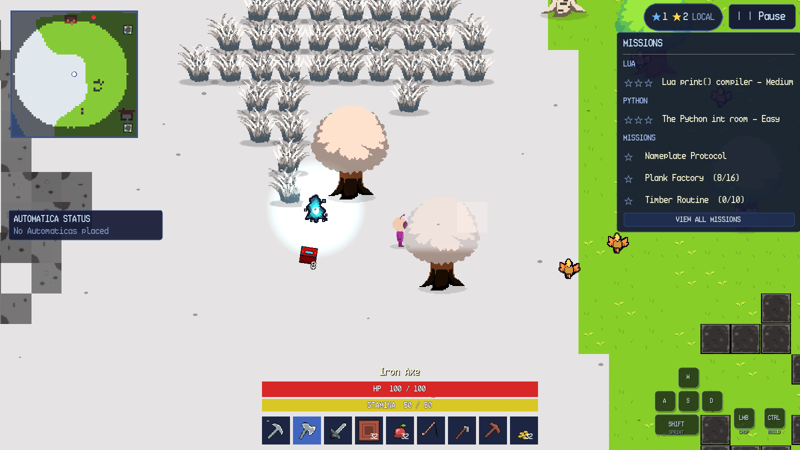{#fig:tree}

## 9.3 Mining and Ores

Placed blocks and cave walls use a hold-to-break model with a minimum pickaxe tier. The wooden pickaxe is tier 1 and can mine stone, iron and copper; the iron pickaxe is tier 5; the diamond pickaxe is tier 10 and reaches diamond ore. {{fig:ore}} shows a placed iron-ore block. Holding the correct pickaxe breaks the block, and the dropped ore is collected by walking over it.

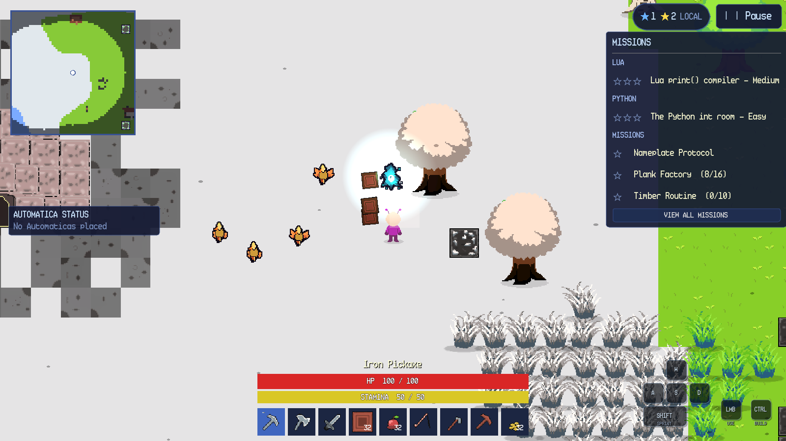{#fig:ore}

Mining is tool-gated by block tier. If the held tool is below the block's minimum tier, the block does not break and the game reports that a better pickaxe is required. A placed block can also be destroyed with Shift+click on desktop, subject to the same tier rule. Release the button to cancel; hold it to chain-break the next block under the cursor after the current one breaks.

## 9.4 Farming

Farming uses a hoe, wheat seeds and tilled ground. A hoe click on open, dry ground within 20 blocks of water creates a tilled plot. A seed click on the plot plants wheat. Wheat matures after 180 seconds; a sword cut harvests a mature crop and may also return a seed. {{fig:farming}} shows a mature wheat crop on tilled ground with the iron hoe selected and the **Tilled Ground** pickup notification visible.

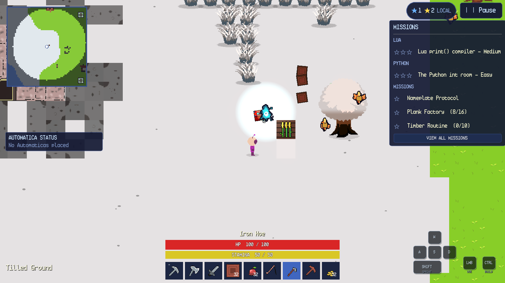{#fig:farming}

Tilling fails if the tile has no ground, is water, is occupied by a placed block, tree, cave entrance or dungeon entrance, or is more than 20 blocks from water. Planting fails if the target is not tilled ground or already contains a crop. A sprout cannot be harvested; the sword cut leaves it growing.

## 9.5 Fishing

Fishing requires a fishing rod in the selected hotbar slot and a click or tap on water within eight blocks. The controller draws a slack line and a bobbing float, as shown in {{fig:fishing}}. The cast lasts five seconds and then rolls a catch chance between 70 and 90 percent. A successful catch reels a fish to the player along an upward arc; a failed attempt ends without an item. Moving more than 64 pixels from the cast point, switching items or leaving the area cancels the attempt.

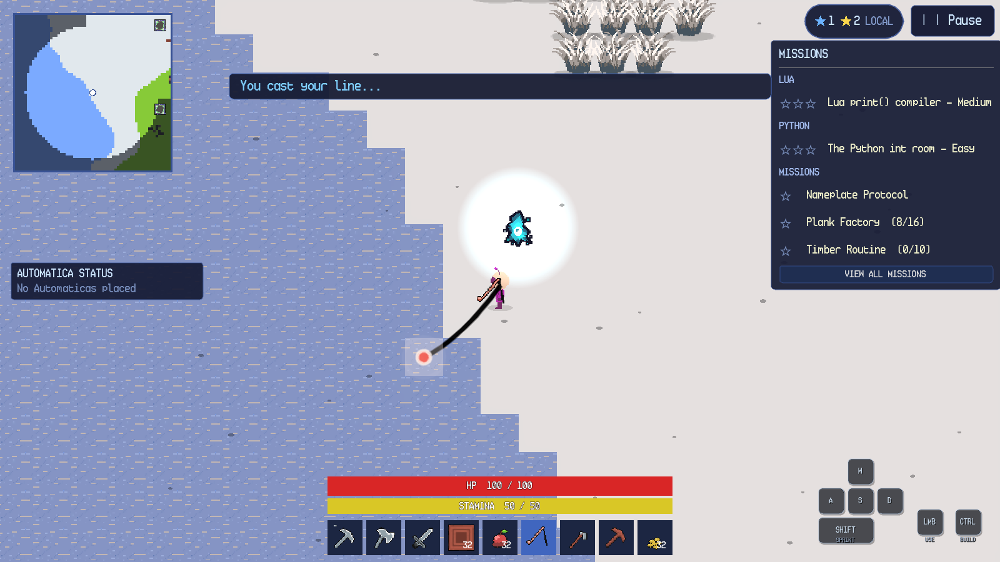{#fig:fishing}

Casting on a non-water tile swings the rod instead. Casting beyond the range produces **Too far to cast — the rod reaches 8 blocks.** and does not start the timer. A second cast while a line is active is ignored.

## 9.6 Waypoints and Fast Travel

Skyglass Waypoint towers are generated across the world. Towers are spread across the world; activate each one you find. A tower displays its name and the instruction **click to open waypoint map**. Interacting with the tower opens the world-waypoint map. The map header reads **WORLD WAYPOINTS**; the legend distinguishes the player, the current waypoint and other world waypoints. Selecting a teal diamond travels to that tower. A tower can be used again after the map closes.

Waypoints are persistent per world. Their identities and positions are saved with the world, so a reload restores the same network. Dungeons also contain temporary one-way waypoints near the player; these target permanent world towers and are described with dungeon navigation.

## 9.7 Bonfires and Respawn

A Bonfire is a placeable respawn anchor. Placing and activating one sets the player's respawn point; only one Bonfire is active at a time. Breaking the active Bonfire clears the respawn point and returns the player to the world spawn on the next death. The Bonfire is also a light source and uses the same placement and destruction rules as other placeable objects.

## 9.8 Creatures and Combat

The world is home to creatures such as Wolf, Sheep, Desert Worm, Headless Fish, Pixie and several dungeon enemies. Hostile creatures approach and attack the player; passive creatures flee or wander. A creature that takes damage shows a name and health bar for a short time, and a damage number appears at the hit location. {{fig:combat}} shows a wolf after a hit, with the player's sword selected and the wolf's health state visible.

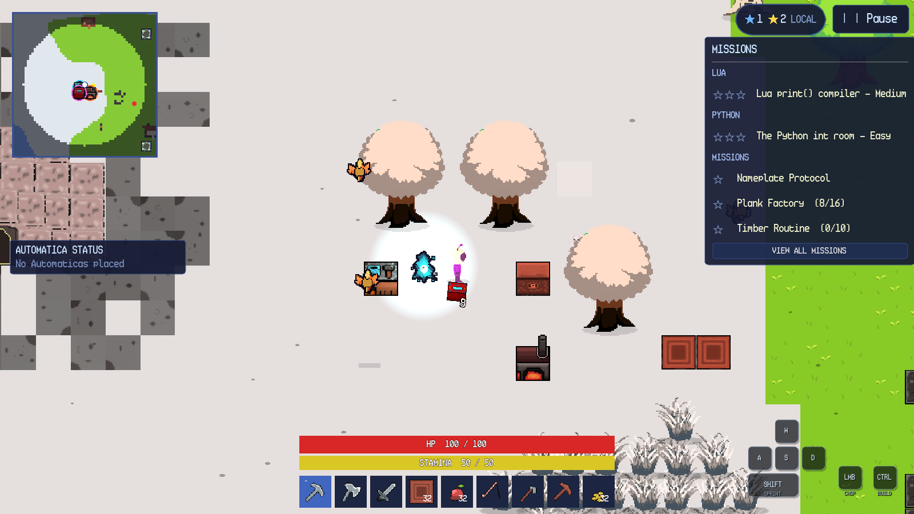{#fig:combat}

Sword swings use the aimed direction and can hit creatures and cut grass or wheat in a row. A creature's contact damage is reduced by day for naturally spawned daytime creatures. Safe zones in dungeons disintegrate hostiles and grant no loot. The Bestiary records a creature when it is first seen and reveals its full details after it is defeated.

## 9.9 Other Overworld Interactions

{{tab:overworld-actions}} summarises the remaining overworld interactions.

Table: Overworld interactions. {#tab:overworld-actions}

| Object or action | How to interact | Result | Failure behaviour |
| --- | --- | --- | --- |
| Grass tuft | Walk through or swing a sword | Walkable decoration; sword cut may drop wheat seeds. | No collision; no failure. |
| Tree | Hold left click / tap with any tool; axe is faster | Drops wood; completes tree mission. | Out of range or wrong aim cancels. |
| Placed block or ore | Hold left click with a sufficient pickaxe | Breaks and drops the block. | Insufficient tier reports a tool requirement. |
| Dropped item | Walk over it | Collected into inventory or hotbar. | Full inventory leaves it on the ground. |
| Tilled plot | Hoe click on suitable ground | Creates farmland. | Too far from water, occupied or invalid ground fails. |
| Wheat crop | Sword cut when mature | Drops wheat and possibly seeds. | Sprout is left growing. |
| Water | Fishing rod click within range | Starts a five-second cast. | Non-water or out-of-range cast fails. |
| Bonfire | Place and activate | Sets respawn point; provides light. | Only one active; breaking clears it. |
| Chest | Left click | Docks storage beneath inventory. | Shift+click destroys instead. |
| Crafting station | Left click | Opens crafting and Algorithmica. | Out of range or UI open blocks. |
| Furnace | Left click | Opens smelting and Algorithmica. | Out of range or UI open blocks. |
| Color Crafter | Left click | Opens colour mixing. | Out of range or UI open blocks. |
| Lua station | Left click | Opens Automatica editor. | Combat mode blocks code execution. |
| Waypoint tower | Left click | Opens world-waypoint map. | Out of range or UI open blocks. |
| Dungeon portal | Left click | Opens enter/cancel confirmation. | Cancel leaves the world unchanged. |
| Cave entrance | Left click | Opens enter/cancel confirmation. | Cancel leaves the world unchanged. |
| Creature | Left click with a weapon | Attacks; hostile creatures retaliate. | Out of range or no weapon still swings. |

# Chapter 10. Inventory and Item Management

## 10.1 Inventory Layout

The inventory panel is shown in {{fig:inventory}}. It has four tabs — **INVENTORY**, **CRAFT**, **ENCYCLOPEDIA** and **BESTIARY** — a **CLOSE** button, a grid of twenty slots, a details sidebar, a trash drop area and the persistent hotbar below the panel. The hotbar has nine slots on desktop and eight item slots plus **INV** on Android. The inventory itself has twenty slots; each slot can hold a stack whose limit is defined by the item, with a global default of 32 and a limit of one for tools.

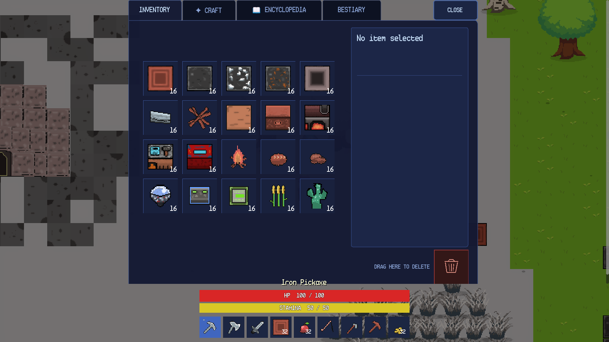{#fig:inventory}

Selecting a slot shows the item's name, quantity, type, effect and description in the sidebar. For a Wood stack, the panel shows **Qty: 16 / 32**, type **Block**, and the description **Basic crafting material**. A plain click selects and inspects; it does not move the stack.

## 10.2 Drag and Drop

Dragging a stack from one slot to another swaps the two stacks. The source slot is marked as the drag source, the target slot is outlined in yellow and a semi-transparent preview follows the pointer. A semi-transparent preview follows the pointer while the source stack is still visible. Dropping onto an empty slot moves the stack; dropping onto a compatible stack merges up to the stack limit; dropping onto an incompatible stack swaps. Dropping onto the trash icon deletes the dragged stack. The chest view uses the same slot component, so items can be dragged between the player inventory and chest storage in either direction.

The inventory does not provide right-click splitting. Stack splitting is performed by dragging a stack onto an empty slot and then rearranging; there is no dedicated split control. This is a limitation of the current interface, not an omitted instruction.

## 10.3 Craft Tab

The **CRAFT** tab lists recipes that can be crafted without a crafting station. The four category buttons are **Materials**, **Blocks**, **Weapons & Tools** and **Others**. Selecting a recipe shows its ingredients, the result and a craft button. The button reads **CRAFT** when the player has the required items and **MISSING MATERIALS** otherwise. {{fig:craft-tab}} shows the Blocks category with the Color Crafter recipe selected; the cactus requirement is red because the player has 16 of the required 20.

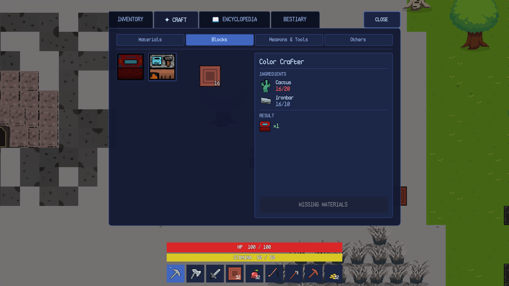{#fig:craft-tab}

Station-required recipes do not appear in the inventory craft tab; they are listed in the crafting-station menu. The inventory recipe set is therefore smaller than the full recipe set. 

## 10.4 Encyclopedia

The **ENCYCLOPEDIA** tab is the Programming Encyclopedia. It contains four accordion sections: **LUA Programming Language**, **Automatica — LUA Functions**, **Python Programming Language** and **Algorithmica — Python Functions**. Language entries unlock through dungeon knowledge; the two function sections are always available. {{fig:encyclopedia}} shows the Automatica section expanded with the full function list.

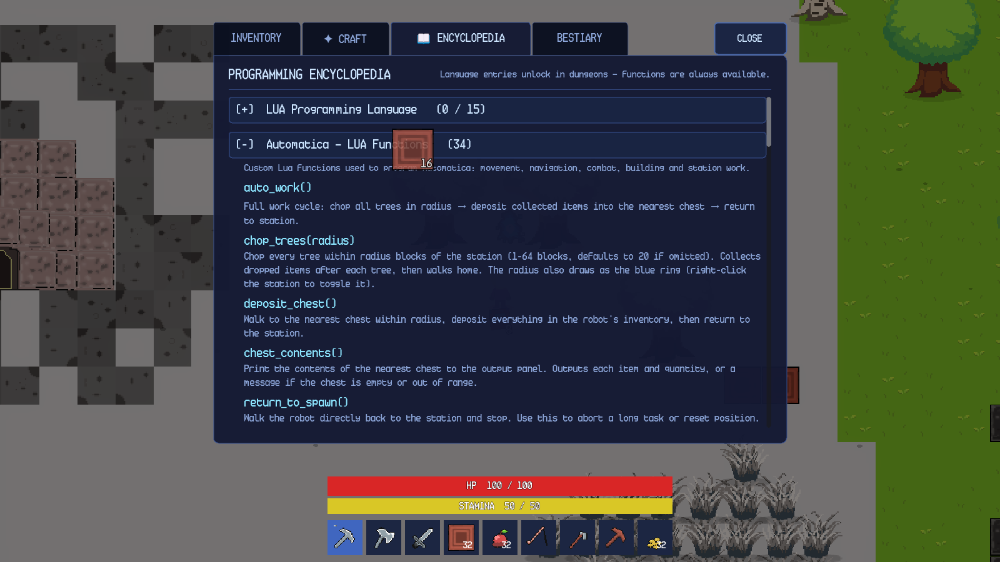{#fig:encyclopedia}

The counts in the section header show the number of entries currently discoverable and the total entry count. The in-game encyclopedia lists 34 Automatica entries, which corresponds to 30 functions plus four read-only variables. The language sections show **0 / 15** for Lua before dungeon discovery; the count increases as knowledge entries are learned.

## 10.5 Bestiary

The **BESTIARY** tab records creature sightings and defeats. A sighting reveals the creature's name, habitat and silhouette. A defeat reveals its field notes, maximum health and complete drop table. The header reports **1 sighted • 0 studied**, and the detail panel explicitly says **Defeat this creature once to reveal its field notes, maximum health and complete drop table.** The Bestiary is per world, so a new world starts with an empty record.

## 10.6 Item and Stack Rules

Every item has a name, type, icon, stack size and, where relevant, combat, food or smelting data. Tools do not stack; most materials stack to 32. A full inventory causes new pickups to remain on the ground or, for mission and dungeon rewards, to enter the pending-overflow queue and be dropped beside the player when space becomes available. The game never silently deletes a reward when the inventory is full.

Table: Inventory slots and stack rules. {#tab:inventory-slots}

| Container | Slots | Notes |
| --- | --- | --- |
| Hotbar (desktop) | 9 | Tools, blocks, food and utility items. |
| Hotbar (Android) | 8 item slots + INV | The last slot is reserved for the inventory button. |
| Player inventory | 20 | Grid with a details sidebar and trash area. |
| Chest storage | 8 | Docked beneath the player inventory while open. |
| Stack limit | Item-defined, default 32 | Tools have a limit of one. |
| Overflow | Pending queue | Rewards are dropped beside the player when space becomes available. |

# Chapter 11. Crafting and Stations

## 11.1 Crafting Overview

Crafting is split between hand crafting in the inventory and station crafting at a Crafting Station. A recipe has a result item, a result quantity, up to two ingredients, a category and a station requirement. The current recipe catalogue contains 48 recipes. Hand crafting excludes station-required recipes; station crafting includes them. Both interfaces show the same ingredient, result and availability rules.

## 11.2 Inventory Crafting

The inventory craft tab is described in Chapter 10. {{fig:craft-tab}} shows a recipe with a missing ingredient and a disabled action. When all ingredients are present, the action button becomes **CRAFT** and consumes the ingredients from the hotbar and inventory. The new item is added to the inventory or dropped beside the player if the inventory is full. Crafting completes the **craft_item** mission objective and contributes to side-mission progress.

## 11.3 Crafting Station

A placed Crafting Station opens the menu shown in {{fig:station}}. The left side lists the player's inventory and build slots. The right side lists station recipes by category. Selecting a recipe shows its ingredients and result; the action button reports **CRAFT** or **NOT ENOUGH MATERIALS**. The **ALGORITHMICA** button opens the Python editor described in Chapter 15. The **CLOSE** button closes the menu.

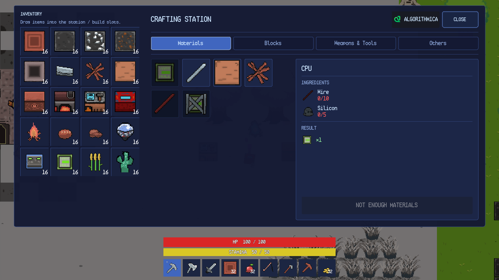{#fig:station}

Station recipes include planks, sticks, charcoal, iron rods, tools, furniture and automation items. A recipe can draw ingredients from the station's input slot and from the player's inventory. The station owns its input, output and automation state; the UI only calls the station's public methods. A Lua robot can also operate a nearby station through `set_recipe`, `craft`, `put_input`, `input_slot` and `take_output`.

## 11.4 Furnace

A placed Furnace opens the smelting menu shown in {{fig:furnace}}. The menu has an inventory grid, an input slot, a fuel slot, an output slot and a **SMELT** button. The input slot accepts smeltable items such as iron ore; the fuel slot accepts wood or charcoal. The status line reports **Smeltable** when the input and fuel are valid. The **ALGORITHMICA** button opens the furnace Python editor. The **CLOSE** button closes the menu.

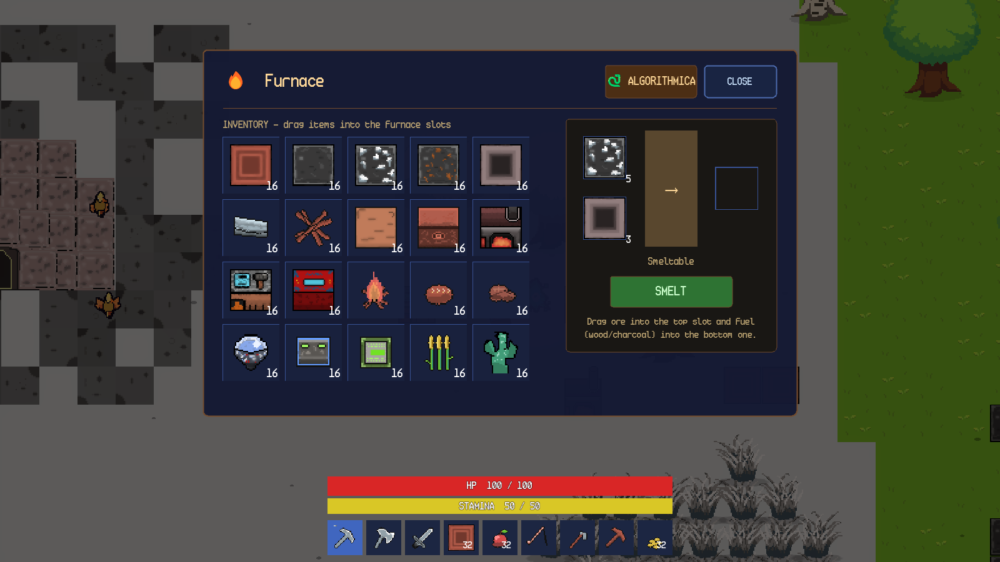{#fig:furnace}

Smelting consumes one input and one fuel per item. The furnace continues to cook while its menu is open. Removing the input or fuel stops the cook. The output slot must be emptied before a new smelt can start when the output stack is full. The furnace can also be loaded by an Algorithmica program; the menu uses drag-and-drop.

## 11.5 Color Crafter

The Color Crafter is a placeable station that creates solid-colour blocks from a cactus-based economy. The colour wheel selects hue and saturation; the vertical **Value** slider controls brightness. The R, G and B fields accept 0–255 integers, and the preview swatch shows the resulting colour. The **Craft** button reads **Craft (uses 1 Cactus)** and is enabled only when the player has at least one cactus. Each crafted block consumes one cactus. The Algorithmica `craft_color(r, g, b, amount)` function implements the same economy from code.

Pure black and pure white are rejected; the menu reports **Pure black and pure white are not allowed.** The output goes to the station's output slot in code mode; the manual UI adds the block directly to the player inventory, or drops it if the inventory is full.

## 11.6 Station and Recipe Reference

{{tab:stations}} summarises the crafting-related stations.

Table: Crafting stations and their interfaces. {#tab:stations}

| Station | Interface | Inputs | Outputs | Programming access |
| --- | --- | --- | --- | --- |
| Crafting Station | Inventory grid, recipe list, output section | Player inventory and station input slot | Crafted items | Algorithmica and Lua station helpers |
| Furnace | Inventory grid, input/fuel/output slots | Smeltable item and fuel | Smelted item | Algorithmica |
| Color Crafter | Colour wheel, RGB fields, preview | One cactus per block | Solid-colour block | Algorithmica `craft_color` |
| Chest | Docked storage grid | Player inventory | Stored stacks | Lua `deposit_chest`, `chest_contents`, `withdraw` |

## 11.7 Crafting Failure Behaviour

A recipe with insufficient ingredients shows **MISSING MATERIALS** or **NOT ENOUGH MATERIALS** and does not consume anything. A station recipe that requires a station cannot be crafted from the inventory tab. A furnace with no fuel reports that fuel is required; a furnace with an invalid input reports that the item is not smeltable. A full output slot blocks a new smelt. A full player inventory causes the crafted result to be dropped beside the station or player rather than deleted.

# Chapter 12. Dungeons and Missions

## 12.1 Mission Structure

Missions are grouped into the Python track, the Lua track and the side missions. {{tab:dungeon-tracks}} in Chapter 2 lists the indices and content of each track. Each dungeon links a Knowledge Entry, a set of quiz questions and a reward.

## 12.2 Finding and Entering a Dungeon

Dungeon entrances are stone gates placed in the overworld. {{fig:dungeon-entrance}} shows a Python dungeon entrance. The gate has a glowing portal, a stone frame and a yellow outline when the player is close. A left click opens the confirmation dialog. The dialog names the dungeon and difficulty, asks **Enter the dungeon?** and provides **Enter** and **Cancel**. Cancel closes the dialog without changing the world.

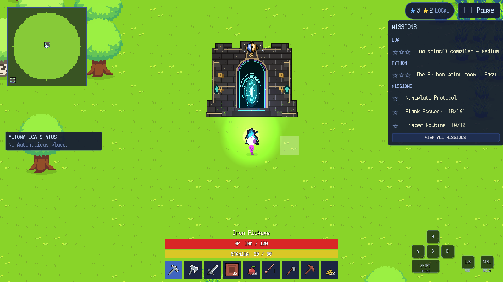{#fig:dungeon-entrance}

Entering builds the dungeon from the mission layout. The overworld is preserved, and the player, hotbar and pause menu carry over. The entrance room has stone walls, a tiled floor, the entrance arch, a safe-zone floor marker and the player. The minimap switches to dungeon fog and shows the explored rooms and altar markers.

## 12.3 Dungeon Layout and Navigation

A generated dungeon contains a guaranteed knowledge room, a guaranteed quiz room, optional altar/checkpoint rooms and optional chest rooms. Rooms are connected by corridors. The knowledge room is a safe zone: stepping on its green marker makes the player invulnerable, heals one health per second and disintegrates hostiles inside the room. The quiz room is not a safe zone. Traps and hostile guards appear near the quiz altar, and rare chests appear in loot rooms.

The dungeon waypoint system places a temporary one-way waypoint near the player at the entrance. The waypoint targets a permanent world tower. Dungeon waypoints are saved with the world and are restored on re-entry. A cleared dungeon removes its overworld entrance and forgets the temporary waypoint.

## 12.4 Knowledge Altar

The Knowledge Altar is the teaching station in the first room. The altar has floating pages and a diamond above it. Interacting with it records the mission's Knowledge Entry and unlocks its keyword in the Programming Encyclopedia. The entry for Python `print()` has a scrollable body and a **Continue** button. Closing the panel releases the UI pause and leaves the dungeon running.

The Knowledge Altar also provides an archive of every knowledge entry unlocked in the world. The archive is pageable and lists entries in a stable order. A new world starts with no archive entries; the first dungeon adds the first entry.

## 12.5 Quiz Altar

The Quiz Altar is the orb in the final room. Interacting with it opens the quiz panel. The panel header reports the question number and total, a **HINT** button, a **RUN** button for compiler questions and a **CLOSE** button. The question text is above a code editor and an output console. {{fig:quiz-question}} shows the first question of the Python print room: **Print "Hello world, this is my first Python code."**

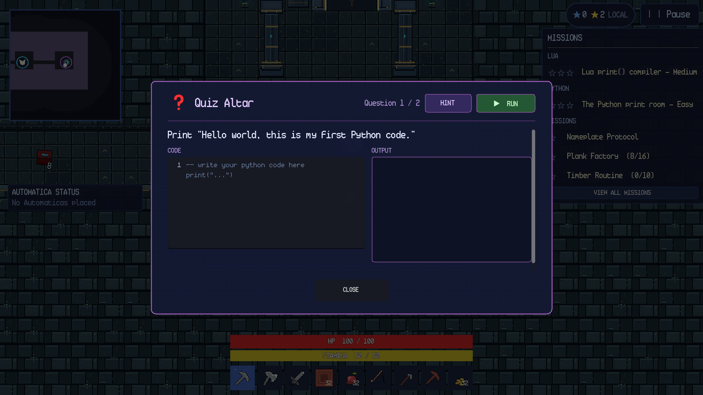{#fig:quiz-question}

The quiz supports two question types. A multiple-choice question presents up to four answer buttons and grades the selected index. A compiler question presents a code editor, an output console and a **RUN** button; the program's printed output is compared with the expected output after whitespace and case normalisation. The Python print room uses two compiler questions.

## 12.6 Hints and Penalties

Pressing **HINT** reveals the answer as faded ghost text in the code editor and changes the button to **NEXT**. The hint does not submit the answer; the player must type the code and press **RUN**. In the first main dungeon, hints are free; in later dungeons each hint or wrong run removes one blue star. The results screen states the rule: **3 stars start • each hint or wrong run costs 1 • first-dungeon hints are free • 0 stars still clears.**

A wrong compiler answer prints the submitted output but does not advance the question. For example, an incorrect program prints `wrong answer` in the console. The mismatch is recorded as a star penalty and the player can edit the code and run again.

When the output matches, the panel reports **Correct!**, advances after a short delay and shows the next question. The editor and output are reset for the new question.

## 12.7 Results, Stars and Rewards

Answering all questions correctly clears the dungeon. The dungeon is completed and the reward is granted before the results screen opens, so the results screen is presentation-only and cannot duplicate progression. {{fig:quiz-results}} shows the results for the Python print room: **DUNGEON CLEARED**, difficulty **Easy**, **Questions answered 2 / 2**, **Hints used 1**, **Star penalties 1**, **Dungeon reward CPU**, two blue stars and the button **DONE — RETURN TO WORLD**. A bonus Life Crystal was also dropped nearby, as reported by the top notification.

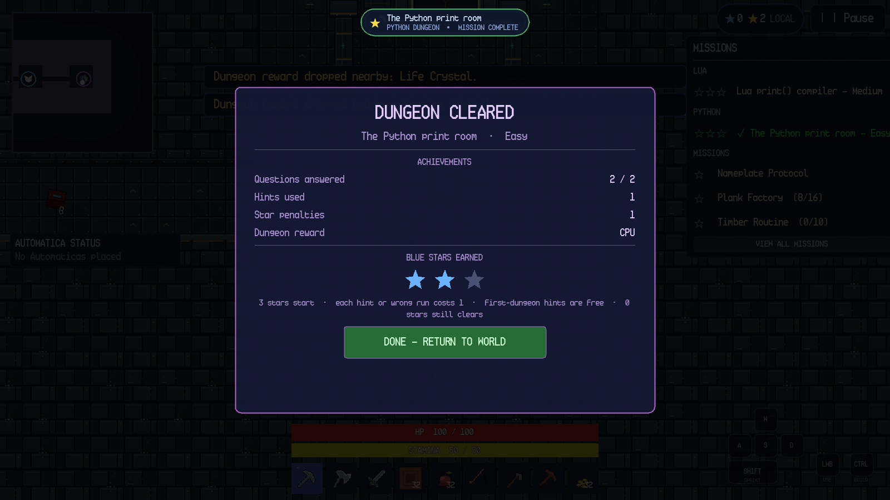{#fig:quiz-results}

Pressing **DONE — RETURN TO WORLD** opens the **WHAT YOU'VE LEARNED** summary. The summary lists the concepts practised, the key idea (`print()`), the Python code that was run, the hint usage and the encyclopedia unlock. The **CONTINUE** button closes the summary, exits the dungeon and returns the player to the overworld entrance.

## 12.8 Mission Stars and Progression

Completing a dungeon grants the dungeon mission star and a clear star, with a perfect bonus at three blue stars. Yellow stars are mission rewards; blue stars are dungeon-performance rewards. The star summary in the HUD shows both totals. The mission tracker marks a completed dungeon with a check and updates the next available mission. Finishing the Lua track completes the mission list; the twenty side missions remain available alongside and after the tracks.

This manual documents the shared dungeon flow. Later Lua missions use the same altar, quiz and results components; individual walkthroughs for every mission are not included.

# Chapter 13. Cave Exploration

## 13.1 Regular Caves

Regular cave entrances are large rock structures with a dark doorway. {{fig:cave-entrance}} shows an entrance in a snowy biome. The doorway is outlined in yellow when the player is close. A left click opens the confirmation dialog, which reads **Large Cave Entrance** and **Enter the cave?** with **Enter** and **Cancel**.

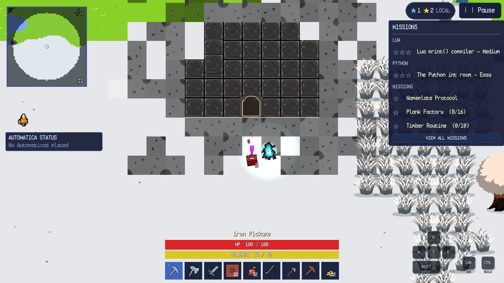{#fig:cave-entrance}

Entering loads a cave with its own walls, ore, lighting, creatures and exit. The minimap switches to cave fog. The exit door returns the player to the overworld entrance. Re-entering a visited cave preserves its state, and saving and loading restores the same cave.

## 13.2 Pixie Caves

Pixie Caves use a pink stone entrance and a purple interior. The confirmation dialog reads **Pixie Cave Entrance** and **Enter the cave?** with **Enter** and **Cancel**. The first Pixie Cave is a safe introduction with no pixies; later Pixie Caves are guarded by pixies. {{fig:pixie-interior}} shows a later cave with ore, crystals and the exit door.

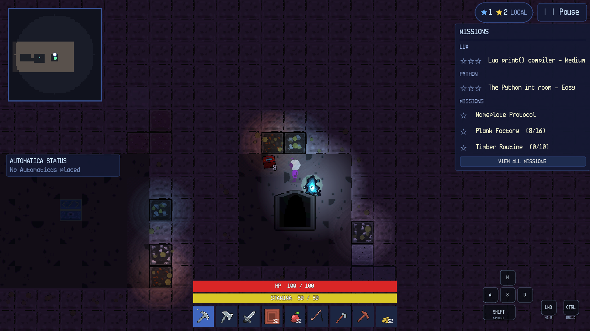{#fig:pixie-interior}

## 13.3 Cave Differences and Persistence

{{tab:cave-comparison}} compares the two cave types. Both use the same entry/exit interaction pattern and the same per-entrance state key, but they differ in art, hazards, creatures and the first-visit safety rule.

Table: Regular caves and Pixie Caves. {#tab:cave-comparison}

| Property | Regular cave | Pixie Cave |
| --- | --- | --- |
| Entrance art | Grey rock and dark doorway | Pink stone and dark doorway |
| Interior palette | Dark blue-grey stone | Purple stone with crystals |
| Common resources | Stone, iron, copper, cave floors | Pixie stone, crystal ores, pixie floors |
| Hostiles | Cave creatures and hazards | Pixies; first cave is safe |
| Exit | Cave exit door | Cave exit door |
| State | Explored tiles remembered per entrance | Explored tiles remembered per entrance |
| Save behaviour | Snapshot on exit and autosave | Snapshot on exit and autosave |

Cave exploration is saved per entrance. The player's explored-tile set is cleared when a new cave is entered and restored from the cave's snapshot when the player returns. A cave that is left while a panel is open closes the panel through the normal cleanup path; it does not leave the game paused. Death inside a cave returns the player to the overworld spawn or active Bonfire.

# Chapter 14. Automatica: Lua Robot

## 14.1 What Automatica Is

Automatica is a programmable Lua robot. Place its station from the Lua item, then click the station or the robot to open the editor. **RUN** starts the program, **STOP** halts the current job, **CLEAR** empties the editor and **ENCYCLOPEDIA** opens the in-game reference. A robot can chop trees, mine, build, fight, deposit items and operate a nearby crafting station. Standard Lua syntax is available, including variables, tables, loops, functions and `print`.

{{fig:lua-editor}} shows the editor with a program ready to run.

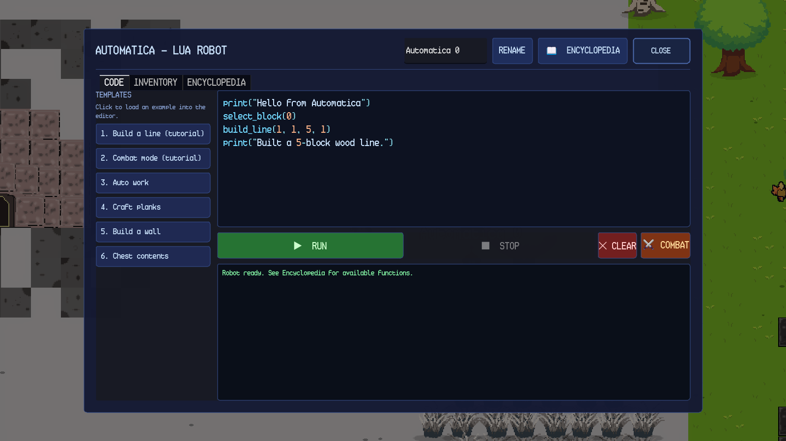{#fig:lua-editor}

## 14.2 Custom Functions

The tables below list every custom Automatica function. Arguments in brackets are optional; the example column shows a valid call.

Table: Automatica robot functions (15). {#tab:lua-robot}

| Function and syntax | Parameters and returns | What it does | Working example |
| --- | --- | --- | --- |
| `auto_work()` | No parameters. Returns nothing. | Full work cycle: chop all trees in radius, deposit collected items into the nearest chest, return to the station. | `auto_work()` |
| `chop_trees(radius)` | `radius` is a number of blocks, 1–64; omit for 20. Returns nothing. | Chops every tree within the radius, collects dropped items and walks home. The radius also draws as a blue ring. | `chop_trees(12)` |
| `deposit_chest()` | No parameters. Returns nothing. | Walks to the nearest chest within range, deposits the robot's inventory and returns. | `deposit_chest()` |
| `chest_contents()` | No parameters. Returns nothing; prints the contents. | Prints each item and quantity in the nearest chest, or a message if empty or out of range. | `chest_contents()` |
| `return_to_spawn()` | No parameters. Returns nothing. | Walks directly back to the station and stops. | `return_to_spawn()` |
| `craft_example()` | No parameters. Returns nothing. | Minimal station example: select Planks, craft one and collect it. | `craft_example()` |
| `move(x, y)` | `x` and `y` set direction and speed; positive x is east, positive y is south. Returns nothing. | Moves the robot. `move(0, 0)` stops it. | `move(90, 0)` |
| `interact()` | No parameters. Returns nothing. | Runs the robot's default job: chop all trees and return home. | `interact()` |
| `attack()` | No parameters. Returns nothing. | Swings the robot's held weapon. Requires a tool in the tool slot; otherwise prints `No tool equipped`. | `attack()` |
| `drop_item(qty)` | `qty` is the maximum number to drop. Returns nothing. | Drops up to `qty` copies from the selected build slot, or from the general inventory if the slot is empty. | `drop_item(3)` |
| `place_item(dx = 0, dy = 0)` | Optional tile offsets. Returns nothing. | Places one block from the selected build slot at an offset. With no offsets it places at the robot's tile. | `place_item(1, 0)` |
| `mine(name)` | `name` is the block's internal name. Returns nothing. | Mines every matching placed block in the work radius, paths around walls and skips unreachable blocks. Requires a tool. | `mine("stone")` |
| `rename(name)` | `name` is a string. Returns nothing. | Gives the robot a custom name shown above it. | `rename("Builder")` |
| `combat_mode(on)` | `on` is `true` or `false`. Returns nothing. | `true` sends the robot into combat mode; it follows the player and attacks hostiles. `false` returns it to the station. | `combat_mode(true)` |
| `list_items()` | No parameters. Returns a table of item names. | Returns a sorted list of every item name in the game. | `for _, name in ipairs(list_items()) do print(name) end` |

Table: Automatica building, chest and geometry helpers (10 unique names). {#tab:lua-build}

| Function and syntax | Parameters and returns | What it does | Working example |
| --- | --- | --- | --- |
| `select_block(i)` | `i` is 0, 1 or 2. Returns nothing. | Chooses the build slot used by `place_item`. | `select_block(0)` |
| `place_at(x, y)` | Absolute tile coordinates. Returns nothing. | Places one block from the selected build slot at an absolute tile. | `place_at(12, 8)` |
| `withdraw("name", n)` | Item name or item id, and a maximum quantity. Returns nothing. | Walks to the nearest chest holding the item and takes up to `n`; placeable blocks go to the build palette. | `withdraw("Wood", 10)` |
| `build_line(x0, y0, x1, y1)` | Start and end tile offsets. Returns nothing. | Gap-free straight line of blocks. | `build_line(1, 1, 5, 1)` |
| `build_rect(x0, y0, w, h, filled)` | Top-left offset, width, height and filled flag. Returns nothing. | Rectangle of blocks; `filled = true` builds a slab, otherwise a border. | `build_rect(0, 0, 4, 3, false)` |
| `build_circle(r, filled)` | Radius and filled flag. Returns nothing. | Circle centred on the robot; filled disc or outline. | `build_circle(3, false)` |
| `build_ring(r)` | Radius. Returns nothing. | Hollow ring of radius `r`. | `build_ring(4)` |
| `build_spiral(r, turns)` | Radius and turns. Returns nothing. | Spiral out to radius `r`. | `build_spiral(4, 2)` |
| `build_wave(len, amp)` | Length and amplitude in tiles. Returns nothing. | Sine-wave fence. | `build_wave(6, 1)` |
| `build_stairs(n)` | Number of steps. Returns nothing. | Diagonal staircase. | `build_stairs(4)` |

Table: Automatica station helpers and read-only variables (5 functions + 4 variables). {#tab:lua-station}

| Name and syntax | Parameters and returns | What it does | Working example |
| --- | --- | --- | --- |
| `craft(n)` | Number of crafts. Returns nothing. | Crafts `n` of the station's selected automation recipe. | `craft(2)` |
| `set_recipe(name)` | Output item name. Returns nothing. | Selects the station's automation recipe. | `set_recipe("Planks")` |
| `take_output()` | No parameters. Returns nothing. | Moves the station's finished output into the robot's stores. | `take_output()` |
| `put_input("name", n)` | Item name and quantity. Returns nothing. | Walks to the nearest station and loads `n` of the item into its input slot. | `put_input("Wood", 10)` |
| `input_slot(n)` | Quantity. Returns nothing. | Loads `n` of the selected build-slot item into the station input slot. | `input_slot(5)` |
| `held_item` | Read-only table `{name, quantity}` or `nil`. | The item currently held by the robot. | `print(held_item.name)` |
| `station_recipe` | Read-only string. | The station's selected recipe name. | `print(station_recipe)` |
| `station_output_item` | Read-only string. | The station's pending output item name. | `print(station_output_item)` |
| `station_output_count` | Read-only number. | The station's pending output quantity. | `print(station_output_count)` |

# Chapter 15. Algorithmica: Python for Stations

## 15.1 What Algorithmica Is

Algorithmica is the Python interface built into a Crafting Station and a Furnace. Open the machine and press **ALGORITHMICA**. The editor has a code area, **RUN**, **CLEAR** and **RECIPES**; **CLOSE** returns to the machine. Programs can select a recipe, craft or smelt items and move the output into your inventory.

Algorithmica accepts simple Python statements: variables, `print`, loops over `range`, lists and calls to the functions below. Chained comparisons, `else`, `def` and imports are not supported.

{{fig:py-editor}} shows the station editor.

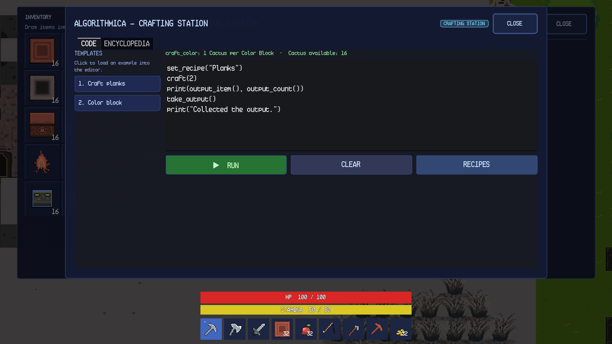{#fig:py-editor}

## 15.2 Crafting Station Functions

{{tab:py-station}} lists the functions available at a Crafting Station.

Table: Algorithmica Crafting Station functions. {#tab:py-station}

| Function and syntax | Parameters and returns | What it does | Working example |
| --- | --- | --- | --- |
| `craft(amount)` | Integer amount. Returns the number crafted, or 0. | Crafts the selected automation recipe, drawing ingredients from the station input slot first and the player inventory second. | `set_recipe("Planks"); craft(2)` |
| `craft_color(r, g, b, amount)` | RGB integers 0–255 and amount 1–32. Returns the number crafted, or 0. | Crafts solid-colour blocks from cactus, one cactus per block. Pure black and pure white are rejected. | `craft_color(255, 0, 0, 2)` |
| `get_recipe()` | No parameters. Returns a string. | Returns the selected recipe name. | `print(get_recipe())` |
| `set_recipe(name)` | Recipe output name. Returns a boolean. | Selects the automation recipe. | `set_recipe("Planks")` |
| `output_item()` | No parameters. Returns a string. | Returns the pending output item name. | `print(output_item())` |
| `output_count()` | No parameters. Returns an integer. | Returns the pending output quantity. | `print(output_count())` |
| `take_output()` | No parameters. Returns the number taken. | Moves the station output into the player's inventory. | `take_output()` |

## 15.3 Furnace Functions

{{tab:py-furnace}} lists the functions available at a Furnace.

Table: Algorithmica Furnace functions. {#tab:py-furnace}

| Function and syntax | Parameters and returns | What it does | Working example |
| --- | --- | --- | --- |
| `feed(name, n)` | Item name and maximum quantity. Returns the number loaded. | Moves up to `n` of the named smeltable item from the player inventory into the input slot. | `feed("iron_ore", 5)` |
| `fuel(name, n)` | Fuel item name and maximum quantity. Returns the number loaded. | Moves up to `n` of the named fuel into the fuel slot. | `fuel("charcoal", 3)` |
| `smelt(n)` | Maximum number to smelt. Returns the number smelted. | Smelts up to `n`, consuming one input and one fuel per item. | `smelt(2)` |
| `take_output()` | No parameters. Returns the number taken. | Moves the output slot into the player inventory. | `take_output()` |
| `input_name()` | No parameters. Returns a string. | Reads the input slot's item name, or `""`. | `print(input_name())` |
| `input_count()` | No parameters. Returns an integer. | Reads the input slot's quantity. | `print(input_count())` |
| `fuel_name()` | No parameters. Returns a string. | Reads the fuel slot's item name, or `""`. | `print(fuel_name())` |
| `fuel_count()` | No parameters. Returns an integer. | Reads the fuel slot's quantity. | `print(fuel_count())` |
| `output_name()` | No parameters. Returns a string. | Reads the output slot's item name, or `""`. | `print(output_name())` |
| `output_count()` | No parameters. Returns an integer. | Reads the output slot's quantity. | `print(output_count())` |

# Chapter 16. Settings and Documentation

## 16.1 Settings Overview

Settings is a shared panel used by the main menu and the in-game pause menu. It has four categories — **Audio**, **Display**, **Gameplay** and **Controls** — plus **Credits** and **Back** buttons. The panel is rebuilt when the UI scale changes, so every category remains usable on a short desktop window and on Android landscape.

## 16.2 Audio

The Audio category provides three sliders: **Master Volume**, **Music Volume** and **SFX Volume**. Each slider ranges from 0 to 100 percent in 5-percent steps and updates the corresponding audio bus immediately. Master Volume affects music and sound effects; Music Volume affects the music bus; SFX Volume affects mining, footsteps, creatures and other effects.

Audio volume changes apply immediately but are not saved, so they return to 100 percent on the next launch.

## 16.3 Display

The Display category provides **Camera Zoom** from 0.5× to 3.0× in 0.1× steps, a **Fullscreen** toggle and, on desktop, a **VSync** toggle. Camera zoom changes the player's camera immediately. Fullscreen and VSync are saved for the next launch. On Android, the Fullscreen control is disabled because the platform owns the window mode, and the VSync control is hidden because the compositor owns presentation timing.

Camera zoom returns to its default on the next launch.

## 16.4 Gameplay

The Gameplay category provides two toggles. **Pause on Inventory** pauses the game while the inventory is open. **Opaque Quest Background** draws the quest tracker on a solid panel instead of floating text. Both toggles apply immediately. Pause on Inventory is a global preference; Opaque Quest Background changes the mission tracker's drawing style.

## 16.5 Controls

The Controls category contains **Point-and-Click Movement**, **Automatic Sprint** and a keyboard rebinding list. Point-and-Click Movement enables click/tap movement and interaction. Automatic Sprint applies the sprint multiplier to point-and-click movement while stamina is available. The keyboard list lets the player click a binding row and press a new key; Escape cancels the rebind. Bindings are saved, survive restarts and are independent of keyboard layout.

Point-and-click is available on both desktop and Android. On Android, enabling it hides the virtual joystick; joystick mode keeps the joystick visible. The setting does not intercept build mode, UI panels or right clicks.

Table: Settings and persistence. {#tab:settings}

| Setting | Category | Values | Persists | Platform notes |
| --- | --- | --- | --- | --- |
| Master Volume | Audio | 0–100% | No | Applied to the Master bus immediately. |
| Music Volume | Audio | 0–100% | No | Applied to the Music bus immediately. |
| SFX Volume | Audio | 0–100% | No | Applied to the SFX bus immediately. |
| Camera Zoom | Display | 0.5×–3.0× | No | Applied to the player camera immediately. |
| Fullscreen | Display | On/Off | Yes | Disabled on Android. |
| VSync | Display | On/Off | Yes | Hidden on Android; 60 FPS cap remains. |
| Pause on Inventory | Gameplay | On/Off | Session only | Affects whether the inventory pauses gameplay. |
| Opaque Quest Background | Gameplay | On/Off | Session only | Changes the mission tracker background. |
| Point-and-Click Movement | Controls | On/Off | Yes | Hides the Android joystick when enabled. |
| Automatic Sprint | Controls | On/Off | Yes | Applies only to point-and-click movement. |
| Key bindings | Controls | Physical keys | Yes | Saved with your settings. |

## 16.6 Help and Documentation

Help & Documentation is opened from the pause menu. It contains nine categories: **Start Here**, **Controls**, **Survival & World**, **Building & Farming**, **Crafting & Machines**, **Programming & Automation**, **Dungeons & Bestiary**, **Maps, Missions & Saving** and **Settings & Troubleshooting**. The panel has a scrollable body and a **Back** button. The footer reports the instruction **scroll to read**.

The **Start Here** category explains the first session, the HUD, the tutorial, the long-term goals and the fact that the game continues after the tracks are complete. The **Controls** category is the primary in-game control reference.

The other categories document survival, building, farming, crafting, programming, dungeons, maps and settings.

The in-game Help panel provides a concise reference. This manual expands on it with detailed instructions, failure behaviour, function signatures and worked examples.

# Chapter 17. Troubleshooting

## 17.1 Authentication and Account Issues

{{tab:auth-troubleshooting}} lists the authentication failures that are implemented and their remedies. The exact player-facing strings are quoted from the account panel.

Table: Authentication troubleshooting. {#tab:auth-troubleshooting}

| Symptom | Cause | Resolution | Reference |
| --- | --- | --- | --- |
| `Enter your username and password.` | One or both fields empty. | Fill both fields and submit again. | Account panel message. |
| `Usernames must be 3-24 characters: letters, numbers or underscore.` | Username too short, too long or contains a space or symbol. | Use 3–24 letters, numbers or underscores. | Account panel message. |
| `Passwords must be at least 6 characters.` | Password shorter than 6. | Use at least 6 characters. | Account panel message. |
| `Passwords can be at most 72 characters.` | Password longer than 72. | Shorten the password. | Account panel message. |
| `The passwords do not match.` | Confirmation differs from password. | Re-enter the same password in both fields. | Account panel message. |
| `That username is already taken.` | Availability check found the username. | Choose another username. | Account panel message. |
| `Incorrect username or password.` | Generic credential rejection. | Re-enter the credentials; the message deliberately does not reveal whether the username exists. | Account panel message. |
| `Too many attempts. Wait a moment and try again.` | Too many attempts in a short time. | Wait and retry. | Account panel message. |
| `The online service is temporarily unavailable.` | The online service is temporarily unavailable. | Retry later. | Account panel message. |
| `Could not reach SandEE online. Check your connection and try again.` | Network failure or offline. | Check the connection and press Retry or reopen the account panel. | In-game message. shows the offline gate. |
| `Account created, but sign-in was not completed. Try signing in again.` | The online service requires confirmation and did not sign the account in. | Sign in again after confirmation. | Account panel message. |
| Leaderboard or cloud save opens a sign-in form. | No live session. | Sign in first. | Chapter 4 |
| Password recovery is unavailable. | No recovery interface is implemented. | No in-game resolution exists currently. | Account panel. |

## 17.2 World and Save Issues

{{tab:world-troubleshooting}} covers world selection, creation and saving.

Table: World and save troubleshooting. {#tab:world-troubleshooting}

| Symptom | Cause | Resolution | Reference |
| --- | --- | --- | --- |
| Continue is disabled. | No readable world for the verified account. | Open Worlds and create or select a world. | {{fig:main-offline}} |
| `Offline play cannot create new worlds. Reconnect to add a world.` | Creation is online-only. | Reconnect and sign in, or play an existing world. | {{fig:worlds}} |
| `That name is already used by another world.` | Duplicate name. | Choose a unique name. | In-game message. |
| `Enter a name for your world.` | Empty name. | Type a name. | World-manager message. |
| Create is disabled at ten worlds. | Per-account cap reached. | Delete a world before creating another. | World-manager behaviour. |
| World card missing after a cloud download. | Ownership sidecar or checksum mismatch. | Refresh the world list; the game fails closed rather than showing an unowned world. | Cloud-save behaviour. |
| Save file left as `.tmp` or `.bak`. | Crash during atomic write. | The next successful load uses the intact file; the temporary file is not treated as a world. | World-manager behaviour. |
| Autosave indicator does not appear. | No active slot or the loading screen is up. | Wait until the world is playable; autosave runs every 60 seconds. | {{fig:hud}} shows the HUD context. |

## 17.3 Inventory, Placement and Interaction Issues

{{tab:gameplay-troubleshooting}} covers common gameplay failures.

Table: Gameplay troubleshooting. {#tab:gameplay-troubleshooting}

| Symptom | Cause | Resolution | Reference |
| --- | --- | --- | --- |
| New item remains on the ground. | Inventory and hotbar full. | Free a slot or move a stack to a chest. | Inventory overflow behaviour. |
| Reward is dropped beside the player. | Inventory full when a mission or dungeon reward was granted. | Pick it up after freeing space. | Reward overflow behaviour. |
| Red placement ghost. | Tile occupied, in water, too far or blocked by the player. | Move to a valid tile within six blocks. | {{fig:build-mode}} |
| Point-and-click order rejected. | No walkable approach to the target. | Move closer or clear the obstruction. | Pathfinding rule. |
| `Too far to cast — the rod reaches 8 blocks.` | Fishing target beyond range. | Cast at water within eight blocks. | Fishing range rule. |
| `Too far from water — soil can only be tilled within 20 blocks of water.` | Hoe used too far from water. | Move the plot closer to water. | Farming rule. |
| Crop does not harvest. | Wheat is still a sprout. | Wait for the 180-second growth time. | Crop growth rule. |
| Furnace does not smelt. | Missing input, fuel or output space. | Load both slots and empty the output. | {{fig:furnace}} |
| Craft button reads `MISSING MATERIALS`. | Missing ingredients. | Gather the listed ingredients. | {{fig:craft-tab}} |
| Chest opens but drag does not transfer. | Drop target is not a compatible slot. | Drag onto an empty or compatible slot. | {{fig:chest-docked}} |
| Death does not delete inventory. | Intended behaviour. | Respawn at the active Bonfire or world spawn. | {{fig:death}} |
| Creature shows a health bar after a hit. | Damage feedback. | Continue attacking or retreat. | {{fig:combat}} |

## 17.4 Dungeon and Progression Issues

{{tab:dungeon-troubleshooting}} covers dungeon entry, quiz and results.

Table: Dungeon troubleshooting. {#tab:dungeon-troubleshooting}

| Symptom | Cause | Resolution | Reference |
| --- | --- | --- | --- |
| Dungeon portal does nothing. | Player not nearby, build mode active, another UI open or pause open. | Leave build mode and close panels, then click the gate. | {{fig:dungeon-entrance}} |
| Quiz will not advance. | Output does not match expected text. | Compare the output console with the question; run again. | In-game message. |
| Hint reduces stars. | Each hint costs one star after the first dungeon. | Use hints only when needed. | In-game message. |
| Results show fewer than three stars. | Hints or wrong runs were used. | Replay the dungeon for a better score if desired. | {{fig:quiz-results}} |
| `Done` opens a summary instead of the world. | The learning summary is shown after the results. | Press **CONTINUE** on the summary. | In-game message. |
| Dungeon completion does not remove the entrance. | The clear is recorded, but the entrance removal occurs on the exit/save path. | Return to the world through the summary and allow the save to complete. | In-game message. |

# Chapter 18. Conclusion

SandEE brings gathering, building, survival, exploration and programming together in one generated world. This manual has followed the full range of play: start a world, learn the controls, gather and craft, survive the overworld, and clear the Python and Lua dungeon tracks.

The order matters less than the habit. Read the tracker, keep your gear current, use the knowledge room to heal, and treat stars as a score rather than a gate: a zero-star clear still advances the missions. Once both tracks are complete, the side missions and the two programming environments give the sandbox its long tail.

The control chapters cover keyboard, mouse and touch play; the programming chapters list every custom Automatica and Algorithmica function. Players can read the manual in order or jump to the chapter they need.

# Chapter 19. Appendices

## Appendix A. Glossary

Table: Glossary of terms used in this manual. {#tab:glossary}

| Term | Meaning |
| --- | --- |
| Automatica | The programmable Lua robot and its editor. |
| Algorithmica | The Python-subset programming interface for crafting stations and furnaces. |
| Knowledge Altar | The dungeon object that records a Knowledge Entry. |
| Quiz Altar | The dungeon object that presents questions and clears the dungeon. |
| Blue star | A dungeon-performance star awarded for a clean run. |
| Yellow star | A mission reward star. |
| Skyglass Waypoint | A persistent overworld fast-travel tower. |
| Pixie Cave | A purple cave type, safe on first visit. |
| PNC | Point-and-click movement. |
| HUD | Heads-up display. |
