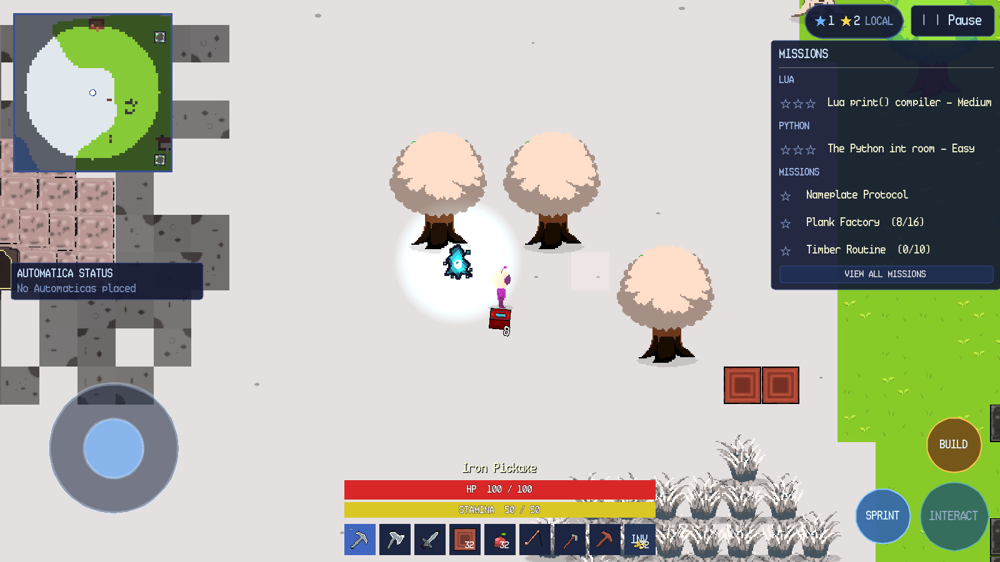
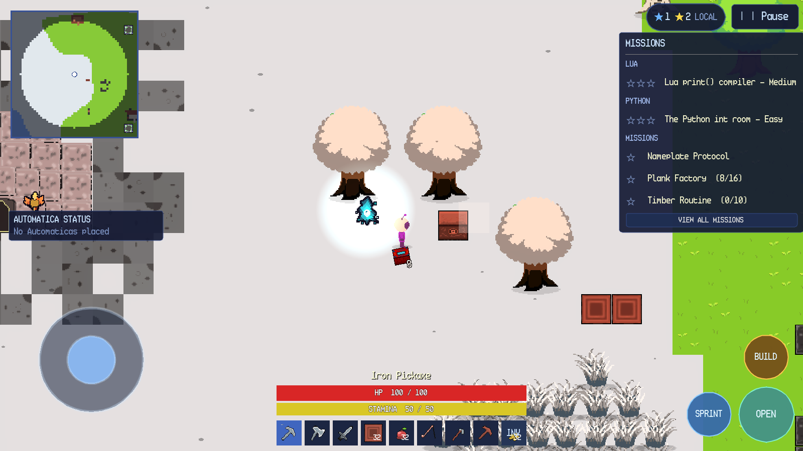
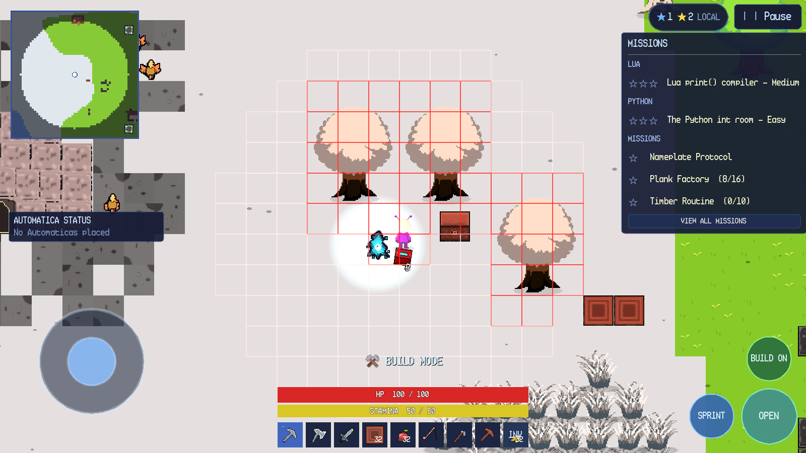
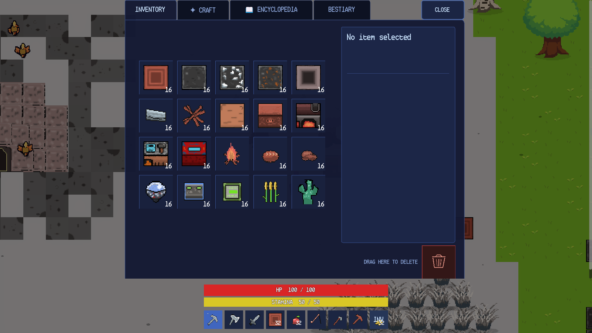
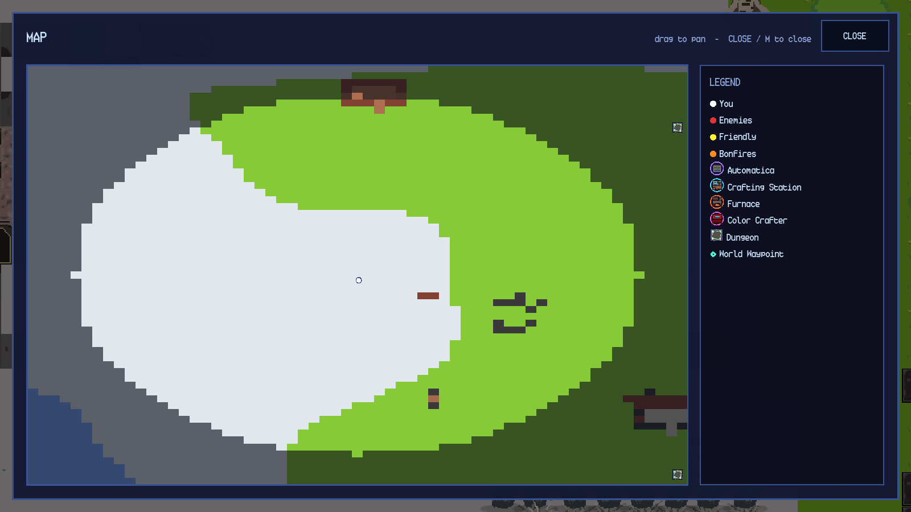

# SandEE Android Control Reference

**Game:** SandEE  
**Platform:** Android touch interface  
**Scope:** Android touch controls for SandEE.

> **Screenshot note:** The Android screenshots show the mobile layout, labels and touch controls in the game's mobile mode. Device-specific cutouts, gesture navigation and on-screen keyboard placement can vary.

## 1. Mobile HUD

The Android HUD replaces the desktop keyboard hints with:

- A virtual movement joystick in the lower-left.
- **SPRINT** and **BUILD** buttons in the lower-right.
- A contextual **INTERACT** button whose label changes to **OPEN**, **CRAFT** or **SMELT**.
- A hotbar with eight item slots and a final **INV** slot.
- The minimap, star summary, mission tracker, health bar and stamina bar in the same logical positions as desktop.

The joystick is visible in joystick mode. It is hidden when point-and-click movement is enabled in Settings → Controls.

## 2. Movement and Multitouch

| Action | Input | Behaviour |
| --- | --- | --- |
| Move | Drag/hold the left joystick | Moves in the joystick direction. |
| Multitouch | Joystick + second finger | The second finger can press action buttons or the hotbar while the first holds the joystick. |
| Sprint | Hold **SPRINT** | Sprint while moving; drains stamina exactly like Shift. |
| Point-and-click | Enable in Settings → Controls | Hides the joystick; taps move, interact or attack. |

## 3. Action Buttons

| Button | Label change | Behaviour |
| --- | --- | --- |
| **SPRINT** | — | Hold to sprint. |
| **BUILD** | **BUILD ON** while active | Toggles build mode. Shows the tile grid and ghost. |
| **INTERACT** | **OPEN** near a chest, **CRAFT** near a crafting station, **SMELT** near a furnace | Opens or uses the nearby object. |
| **INV** | — | Opens the inventory. The last hotbar slot is reserved for it. |

## 4. Tapping the World

| Action | Input | Behaviour |
| --- | --- | --- |
| Move | Tap ground | Moves to the tile in point-and-click mode; in joystick mode the tap can still be used for context actions. |
| Mine/chop | Tap a block or tree with a suitable tool | Starts or advances the break. Hold where the action supports holding. |
| Attack | Tap a hostile creature | Swings at the creature; hostile creatures retaliate. |
| Interact | Tap an NPC, chest, station, furnace, altar or portal | Opens the corresponding interface or dialog. |
| Place block | Tap a valid tile in build mode | Places the selected block. |
| Fish | Tap water with a fishing rod selected | Casts if the water is within eight blocks. |
| Eat | Tap the player with food selected | Consumes one food item if health is not full. |
| Collect item | Walk over a dropped item | Adds it to the inventory. |

## 5. Hotbar and Inventory

The Android hotbar has eight item slots plus **INV**. Tap a slot to select it; the selected item name appears above the bars. Tap **INV** to open the inventory. The inventory grid, details sidebar, trash area, tabs and drag-and-drop behaviour match desktop behaviour.

Drag-and-drop works with touch. A drag preview follows the finger. A tap on a slot selects/inspects; it does not transfer the stack.

## 6. Map

Tap the minimap to open the full map. The Android map uses the same canvas, legend and pan/zoom controls as desktop, with touch dragging for pan and the **CLOSE** button or system Back to close.

## 7. System Back and Text Input

Android system Back follows the same overlay order as Escape on desktop: it closes the innermost panel or menu. While a text field is focused, the on-screen keyboard appears; **DONE** above the keyboard dismisses it. The account panel, world-name field, code editors and search fields use the platform text cursor.

## 8. Menus and Settings on Android

The main menu and pause menu use the same controls as desktop, with touch-sized buttons and safe-area insets. In Settings:

- **Fullscreen** is disabled because the platform owns the window mode.
- **VSync** is hidden because the compositor owns presentation timing.
- **Point-and-Click Movement** hides the joystick when enabled.
- **Automatic Sprint** applies to point-and-click movement only.
- Volume and camera zoom apply immediately but are not persisted.

## 9. Android-Specific Limitations

- Physical-device screenshots were not available.
- Cutout/notch placement, gesture navigation and keyboard inset geometry vary by device.
- The screenshots show the mobile layout; installing the APK on additional devices may reveal device-specific differences.
- The last hotbar slot is reserved for **INV**, so Android has eight item slots instead of nine.
- There is no F1 keyboard hint cluster; the action buttons are always visible.
- There is no mouse cursor; the custom desktop cursor set is disabled.
- Tooltips are hover-only on desktop; Android uses tap/hold item details instead.

## 10. Windows vs Android Summary

| Action | Windows | Android |
| --- | --- | --- |
| Move | WASD/arrows or PNC | Joystick or PNC |
| Sprint | Hold Shift | Hold SPRINT |
| Primary action | Left click/hold | Tap/hold |
| Aim | Mouse pointer | Tap position |
| Inventory | E or control | INV slot |
| Hotbar | 9 slots, 1–9/wheel | 8 slots + INV, tap |
| Build | Ctrl | BUILD / BUILD ON |
| Context interact | Left click object | INTERACT / OPEN / CRAFT / SMELT |
| Destroy placed object | Shift + click | Suitable tool tap/context |
| Map | M or minimap | Minimap tap |
| Pause | Escape or button | Pause button or Back |
| Dialogue | Enter/Space | Tap continue |
| Control hints | F1 toggle | Always-visible buttons |
| Text input | Physical keyboard | On-screen keyboard + DONE |
| Multitouch | Not applicable | Joystick + buttons/hotbar |
