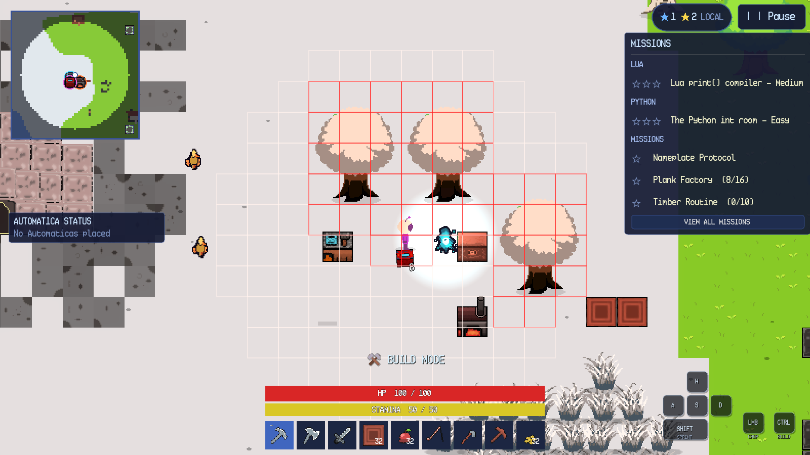
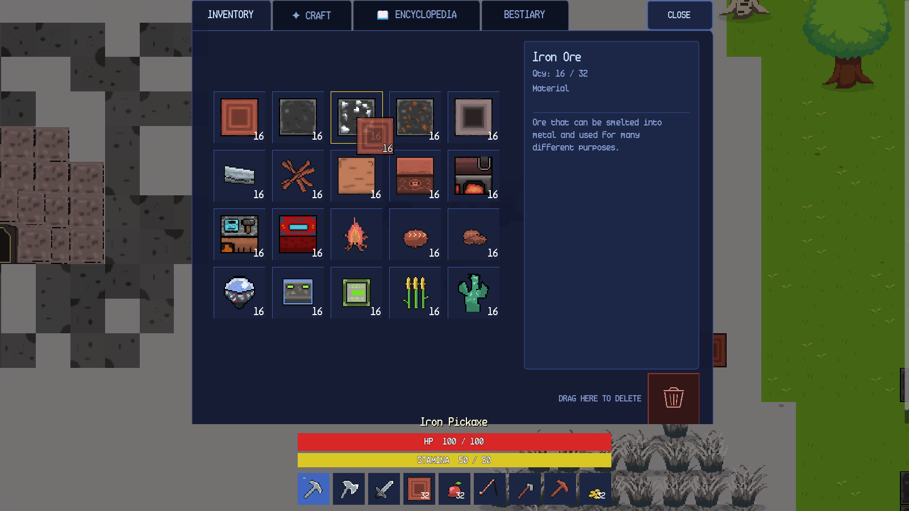
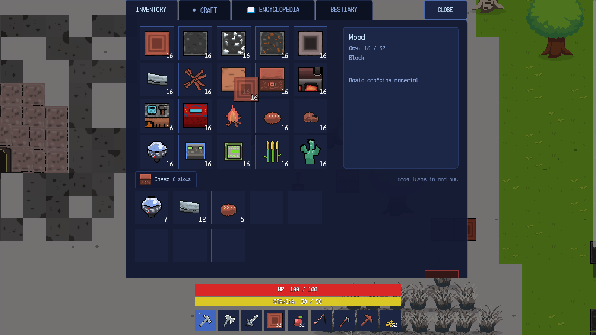

# SandEE Windows Control Reference

**Game:** SandEE  
**Platform:** Windows desktop  
**Scope:** Windows desktop controls for SandEE.

This reference lists the desktop controls available in SandEE. It is a standalone companion to Chapter 7 of `SandEE_User_Manual_Draft.docx`. Screenshots are in `manual_assets/screenshots/`.

## 1. Input Actions

The project input map declares 16 actions:

| Action | Default binding |
| --- | --- |
| `gameplay_up` | W, Up Arrow |
| `gameplay_down` | S, Down Arrow |
| `gameplay_left` | A, Left Arrow |
| `gameplay_right` | D, Right Arrow |
| `inventory` | E |
| `mouse_left` | Left mouse button |
| `escape` | Escape |
| `hotbar_1` … `hotbar_9` | Number keys 1–9 |

The following controls are implemented as direct key or mouse checks rather than InputMap actions: Shift (sprint), Ctrl (build mode), M (map), F1 (control hints), Shift+click (destroy placed object) and right-click on a Lua station (work-radius ring).

## 2. Movement and Camera

| Action | Input | Type | Behaviour | Restrictions |
| --- | --- | --- | --- | --- |
| Move up | W or Up Arrow | Hold | Move north. | Movement cancels a point-and-click order. |
| Move down | S or Down Arrow | Hold | Move south. | Same. |
| Move left | A or Left Arrow | Hold | Move west. | Same. |
| Move right | D or Right Arrow | Hold | Move east. | Same. |
| Sprint | Shift | Hold while moving | 1.8× speed; drains stamina. | Stops at zero stamina; needs 15 stamina to restart. |
| Camera zoom | Settings → Display → Camera Zoom | Slider | 0.5×–3.0×. | Applied immediately; not persisted. |
| Aim | Mouse movement | Continuous | Sets swing, cut, mining and placement direction. | If the pointer is on the player, the last movement direction is used. |

## 3. Primary Mouse Actions

| Action | Input | Type | Behaviour | Restrictions |
| --- | --- | --- | --- | --- |
| Swing / use | Left mouse | Click or hold | Swings the held item, uses a tool, attacks, mines, chops, interacts or places in build mode. | Holding repeats swings. |
| Point-and-click move | Left mouse on ground | Click | Walks to the clicked tile. | Requires Settings → Controls → Point-and-Click Movement. |
| Point-and-click interact | Left mouse on an interactable | Click | Walks to one-block range and opens/uses the target without swinging. | Same setting. |
| Point-and-click attack | Left mouse on a hostile creature | Click | Chases and attacks. | Same setting. |
| Cancel point-and-click | Escape or WASD | Press | Cancels the order. | — |
| Destroy placed object | Shift + left click | Hold/repeat | Mines a block, chest, station or furnace. | Requires a suitable pickaxe, or an axe on wooden objects. |
| Lua station radius | Right click on a Lua station | Press | Toggles the blue work-radius ring. | Does not open the editor. |
| Inventory drag | Left mouse drag | Drag | Moves a stack between slots. | A preview follows the pointer. |
| Item inspect | Left click on an inventory slot | Click | Selects the stack and shows details. | Does not move the stack. |
| Trash | Drag to trash area | Drag | Deletes the dragged stack. | Irreversible. |

## 4. Keyboard Shortcuts

| Key | Action | Context |
| --- | --- | --- |
| E | Open/close inventory | Gameplay; suppressed while a text field has focus. |
| 1–9 | Select hotbar slot | Gameplay. |
| Mouse wheel | Previous/next hotbar slot | Gameplay. |
| Ctrl | Toggle build mode | Gameplay; disabled in dungeons. |
| M | Open/close full map | Gameplay; ignored while paused or typing. |
| Escape | Pause / close innermost panel / cancel point-and-click | Global. |
| Enter or Space | Advance dialogue | Tutorial dialogue. |
| F1 | Show/hide control hints | Desktop gameplay. |
| Shift | Sprint | While moving. |
| Shift + left click | Destroy placed object | Gameplay. |

## 5. Point-and-Click Movement

Enable **Settings → Controls → Point-and-Click Movement**. A left click on open ground issues a pathfinding order. A click on an interactable walks to one-block range and interacts without swinging. A click on a hostile creature chases and attacks. WASD cancels the order. Build mode, UI panels and right clicks are never intercepted. A target with no walkable approach is rejected immediately instead of walking the player into a wall.

**Automatic Sprint** applies to point-and-click movement only and uses the same stamina rules as Shift.

## 6. Build Mode

Press Ctrl. The HUD displays **BUILD MODE**, a tile grid appears around the player and the selected placeable block is previewed as a translucent ghost.

- Valid tile: normal block colour.
- Invalid tile: red (occupied, in water, too far or blocked by the player).
- Placement range: six blocks.
- Build mode is disabled inside dungeons.
- Placing a floor on an occupied cell replaces the floor but keeps a block above it.
- Placing a block on a floor keeps the floor underneath.
- Shift+click destroys a placed object instead of using it.

## 7. Inventory and Hotbar

The desktop hotbar has nine slots. The inventory has twenty slots. Drag a stack onto another slot to swap; drag onto a compatible stack to merge up to the item's stack limit; drag onto the trash area to delete. A plain click selects and inspects but never transfers. The chest view uses the same slot component, so items can be dragged between the player inventory and chest storage in either direction.

## 8. Menus and UI

| Control | Action |
| --- | --- |
| Pause button or Escape | Open pause menu. |
| Resume | Close pause menu. |
| Help & Documentation | Open the nine-category reference. |
| Settings | Open Audio, Display, Gameplay and Controls. |
| Automatica Management | List active Lua units and terminate one. |
| Quit to Menu | Save, leave any cave/dungeon safely and return to the title menu. |
| Close (X/CLOSE) | Close the current panel. |
| Back | Return to the previous panel. |
| M or minimap | Open the full map. |
| Esc in text field | Cancels the current rebind or closes the panel; it does not type. |

## 9. Programming Editors

| Action | Input | Result |
| --- | --- | --- |
| Open Automatica | Left click a Lua station or combat robot | Opens the Lua editor. |
| Run Lua | Click **RUN** | Executes the program; output appears in the console. |
| Stop Lua | Click **STOP** | Stops the robot and clears velocity. |
| Clear Lua | Click **CLEAR** | Empties the editor. |
| Rename Lua | Click **RENAME**, type, confirm | Changes the robot name. |
| Combat mode | Click **COMBAT** | Sends the robot into/out of combat. |
| Open Algorithmica | Click **ALGORITHMICA** at a station or furnace | Opens the Python editor. |
| Run Python | Click **RUN** | Transpiles and executes the program. |
| Clear Python | Click **CLEAR** | Empties the editor. |
| Recipes | Click **RECIPES** | Shows station recipe names. |
| Close editor | Click **CLOSE** | Releases the UI pause. |

## 10. Contextual Object Controls

| Object | Plain click | Shift + click |
| --- | --- | --- |
| Chest | Docks storage beneath inventory. | Mines the chest. |
| Crafting Station | Opens crafting/Algorithmica. | Mines the station. |
| Furnace | Opens smelting/Algorithmica. | Mines the furnace. |
| Color Crafter | Opens the colour menu. | Mines the Color Crafter. |
| Lua Station | Opens the Automatica editor. | Mines the station if the held tool can mine it. |
| Bonfire | Toggles active respawn point. | Mines the bonfire. |
| Waypoint tower | Opens the world-waypoint map. | — |
| Dungeon portal | Opens the enter/cancel dialog. | — |
| Cave entrance | Opens the enter/cancel dialog. | — |
| Tree | Chops when held. | — |
| Placed block/ore | Mines when held with a sufficient pickaxe. | Mines when held. |
| Crop | Sword cut when mature. | — |
| Dropped item | Walk over it to collect. | — |

## 11. Failure and Edge Cases

- Clicking a target out of range does nothing or cancels the current swing.
- A point-and-click order to a tile with no walkable approach is rejected; the player does not walk into a wall.
- Shift+click on an object that requires a higher tool tier does not destroy it.
- Ctrl is ignored while a text field has focus; it is a text-editing modifier there.
- E is ignored while a text field has focus.
- Build mode is disabled inside dungeons.
- A second cast while fishing is ignored.
- A fishing cast beyond eight blocks reports **Too far to cast — the rod reaches 8 blocks.**
- A full inventory leaves a pickup on the ground or drops a reward beside the player.

## 12. Related Figures

| Figure | Topic |
| --- | --- |
| Figure 6.1 | Gameplay HUD. |
| Figure 7.1 | Build mode grid and invalid cells. |
| Figure 7.2 | Chest docked beneath inventory. |
| Figure 10.1–10.3 | Inventory, craft tab and encyclopedia. |
| Figure 9.1–9.5 | Tree, ore, farming, fishing and combat. |
| Figure 14.1 | Automatica editor. |
| Figure 15.1 | Algorithmica editor. |
